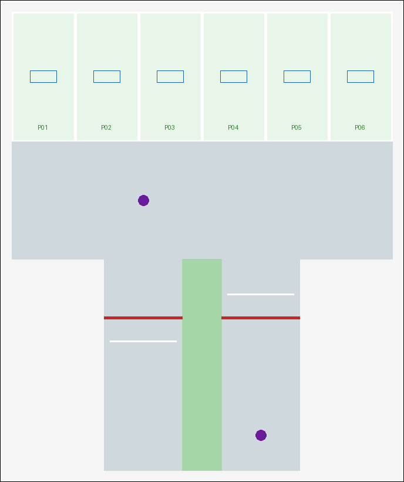
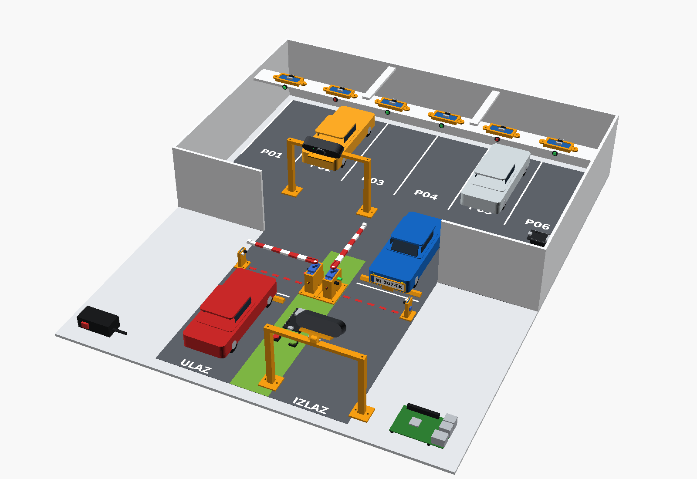
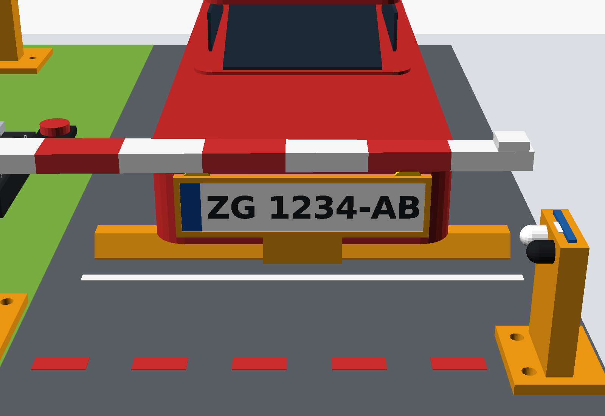

# Nacrt makete

Sve mjere su generirane parametarski: `python SOFTWARE/maketa/alati/tlocrt.py --scale 24 --spots 6` → [nacrt/](../../SOFTWARE/maketa/nacrt)
([tlocrt.svg](../../SOFTWARE/maketa/nacrt/tlocrt.svg) u mjerilu 1:1, [dimenzije.md](../../SOFTWARE/maketa/nacrt/dimenzije.md), `spots.json` za ThingsBoard).
Promijeniš li mjerilo autića ili broj mjesta, ponovno pokreni skriptu.



## 1. Mjerilo autića

| mjerilo | duljina autića | širina | pločica 60 mm | baza za 6 mjesta | ocjena |
|---|---|---|---|---|---|
| 1:64 (Hot Wheels) | ~70 mm | ~30 mm | preširoka | ~350 × 450 mm | ✗ HC-SR04 je veći od mjesta, pločica nečitljiva |
| 1:43 | ~100 mm | ~45 mm | preširoka | ~420 × 560 mm | ~ moguće s pločicom 40 mm (lošiji OCR) |
| 1:32 | ~140 mm | ~60 mm | širina autića | ~530 × 680 mm | ✓ kompromis |
| **1:24** (preporuka) | ~185 mm | ~75–80 mm | stane | **688 × 821 mm** | ✓ najlakše za kameru i senzore |

Pločice su namjerno **veće od mjerila** (stvarna 520 mm bi u 1:24 bila 22 mm – premala za OCR).

## 2. Raspored

- **6 mjesta u nizu** uz sjeverni zid; iznad njih **most** (letva/pjenasti PVC) na ~113 mm visine, na koji se
  odozgo pričvrste HC-SR04 nosači (`3d/nosac_hcsr04.scad`); senzor gleda prema dolje kroz dvije rupe Ø 17 mm u mostu.
  Prazno mjesto ≈ 14 cm do poda, auto ≈ 6–7 cm do krova → velika, stabilna razlika.
- **Prometnica** 200 mm ispred mjesta.
- **Ulazna i izlazna traka** jedna do druge, između njih **otok** (67 mm) – na njemu ESP32 rampi, kabeli i stupovi rampi.
- **Rampe** na istoj crti; ruka rampe donjim rubom na **50 mm**, gornjim na 58 mm iznad poda.
- **IR senzori** (FC-51) na crti rampe s druge strane trake, na visini branika (~18 mm, `3d/nosac_ir.scad`).
  Imaju dvostruku ulogu: "vozilo je stiglo" (pokreće ALPR) i "vozilo je ispod rampe" (zabrana zatvaranja).
- **Zaustavna crta + graničnik kotača** (`3d/granicnik.scad`) 40 mm ispred rampe → autić uvijek stane na isto mjesto
  → kamera uvijek vidi pločicu na istom mjestu (najvažnije za pouzdan ALPR).

Cijela maketa u 3D-u, sa svim isprintanim dijelovima, senzorima, servima i kamerama:
[SOFTWARE/maketa/3d/sklop](../../SOFTWARE/maketa/3d/sklop).



## 3. Kamera

Pločica auta koji čeka gleda **u smjeru vožnje**, a rampa je između kamere i auta. Zato kamera stoji
**na mostu iznad trake**, iza rampe, i gleda koso prema dolje preko ruke rampe:

| | ulaz | izlaz |
|---|---|---|
| auto čeka | izvan rampe (jug), gleda prema sjeveru | unutar garaže (sjever), gleda prema jugu |
| kamera | 200 mm **unutar** crte rampe, 130 mm visoko | 200 mm **izvan** crte rampe, 130 mm visoko |
| čita | prednju pločicu | prednju pločicu |

Provjera geometrije prije lijepljenja:

```bash
python SOFTWARE/maketa/alati/kamera_kalkulator.py --cam-behind 200 --cam-height 130 --hfov 60
```
```
udaljenost kamera-pločica        260 mm      kut gledanja prema dolje  22.6 °
pločica u slici                  256 px      visina znakova            31 px
zraka na crti rampe             46.7 mm iznad poda (ruka rampe 50-58 mm)
OK  ruka rampe ne zaklanja pogled / kut gledanja / veličina znakova / udaljenost fokusa
```

Isto se vidi u 3D sklopu – pogled iz ulazne kamere, ruka rampe prolazi iznad pločice
(detalji u [3d/sklop](../../SOFTWARE/maketa/3d/sklop#što-je-sklop-provjerio)):



**Varijanta A (preporuka):** dvije USB kamere (svaka ~15–25 €), svaka na svom mostu (`3d/most_kamere.scad`).
**Varijanta B (imamo jednu kameru):** jedan most kamere koji se *premješta* između dva položaja; na bazu
zalijepiti po dva graničnika za noge mosta da je položaj uvijek isti. U `edge.yaml` obje rampe koriste istu kameru.

> ⚠️ **Prvi tjedan:** provjeriti **minimalnu udaljenost fokusa** kamere (jeftine kamere s fiksnim fokusom
> su mutne ispod ~30 cm). Snimi pločicu na 20, 25, 30 cm (`SOFTWARE/alpr/tools/capture_dataset.py`) i odaberi.
> Ako je mutno: veća udaljenost (`--cam-behind`) i/ili kamera s autofokusom (npr. Logitech C920).

Osvjetljenje: LED traka s difuzorom (papir za pečenje) iznad zone kamere; bez izravnog svjetla u objektiv;
pločice na **mat** papiru (sjajni odsjaj uništava OCR).

## 4. Materijal

| materijal | + | − | preporuka |
|---|---|---|---|
| **pjenasti PVC (Forex) 5 mm** | ravan, lako se reže skalpelom, lijepi se, čist izgled | cijena (~15–25 €/m²) | **baza i zidovi** |
| šperploča 4–6 mm | čvrsta, nosi težinu, vijci drže | treba pila, brušenje, teža | baza ako maketa putuje |
| čvrsti karton / kapa ploča | jeftin, brz | savija se, upija vlagu, kratko traje | samo za prvi prototip |
| 3D ispis (PLA) | precizni nosači, ponovljivo | sporo za velike plohe | nosači, rampe, mostovi |

Oznake mjesta: bijela izolirka 5 mm ili tiskani predložak (`python SOFTWARE/maketa/alati/tlocrt.py --print-tiles` → A4 listovi
za lijepljenje, 10 mm preklopa).

## 5. Faze izrade (foto-dnevnik za svaku!)

1. Baza izrezana, tlocrt prenesen (predložak ili mjerenje iz `dimenzije.md`)
2. Kanali za kabele ispod/uz rub baze (`3d/kabelski_kanal.scad`), rupe za prolaz kabela
3. Most iznad mjesta + nosači HC-SR04 (bez elektronike) – provjeri da autić prolazi ispod
4. Stupovi i ruke rampi (`3d/rampa_sg90.scad`), IR nosači, graničnici kotača
5. Most(ovi) kamere – provjera kadra kamerom prije lijepljenja
6. Napajanje: razvodna pločica 5 V / GND, kondenzator, sklopka
7. Ožičenje po shemi, oznake kabela, provjera multimetrom (bez ESP32!)
8. ESP32 spojeni, prvi test (osobe 3 i 4)
9. Završni izgled: oznake mjesta, natpisi ULAZ/IZLAZ, pločice na autićima (`3d/drzac_tablice.scad`)

## 6. Kriterij završetka

Maketa se uključi jednom sklopkom, bez ručnog premještanja žica; svi senzori stabilno montirani; kamera
ima ponovljiv pogled na pločicu (10 uzastopnih dolazaka → pločica uvijek u kadru, `evaluate_detection.py` ≥ 90 %).
