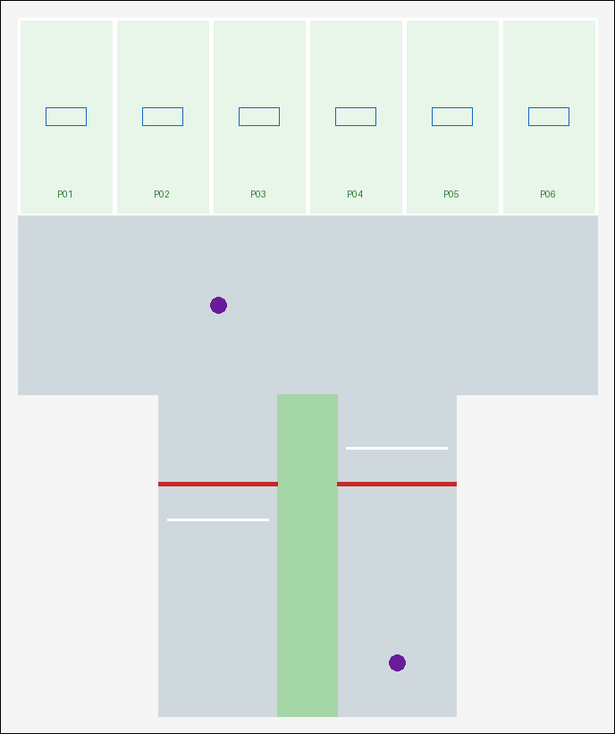
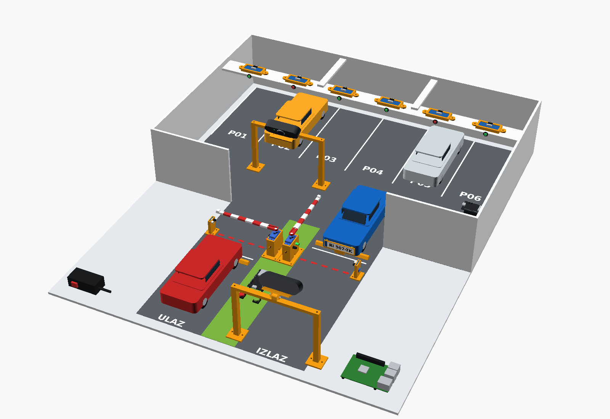
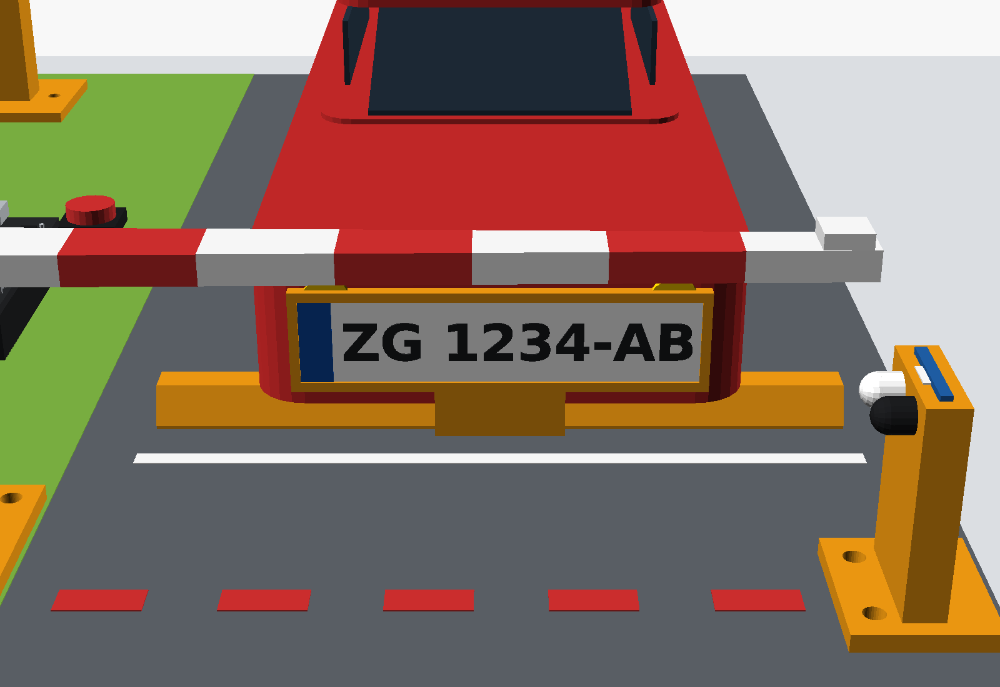

# Nacrt makete

Sve mjere su generirane parametarski: `python SOFTWARE/maketa/alati/tlocrt.py --scale 24 --spots 6` → [nacrt/](../../SOFTWARE/maketa/nacrt)
([tlocrt.svg](../../SOFTWARE/maketa/nacrt/tlocrt.svg) u mjerilu 1:1, [dimenzije.md](../../SOFTWARE/maketa/nacrt/dimenzije.md), `spots.json` za ThingsBoard).
Promijeniš li mjerilo autića ili broj mjesta, ponovno pokreni skriptu.



## 1. Mjerilo autića

Preporuka je 1:24 (autić ~185 × 75–80 mm, baza za 6 mjesta 688 × 821 mm), jer je najlakše za kameru i senzore. 1:32 je
kompromis (baza ~530 × 680 mm), u 1:43 stane samo pločica od 40 mm (lošiji OCR), a u 1:64 je HC-SR04 veći od mjesta.
Pločice su namjerno veće od mjerila, jer bi stvarna pločica od 520 mm u 1:24 imala 22 mm, što je premalo za OCR.

## 2. Raspored

- 6 mjesta u nizu uz sjeverni zid. Iznad njih je most (letva ili pjenasti PVC) na ~113 mm visine, na koji se odozgo
  pričvrste nosači HC-SR04 (`3d/nosac_hcsr04.scad`). Senzor gleda prema dolje kroz dvije rupe Ø 17 mm u mostu.
  Do poda praznog mjesta ima ≈ 14 cm, a do krova auta ≈ 6–7 cm, pa je razlika velika i stabilna.
- Prometnica je 200 mm ispred mjesta.
- Ulazna i izlazna traka su jedna do druge, a između njih je otok (67 mm) s ESP32 rampi, kabelima i stupovima rampi.
- Rampe su na istoj crti. Ruka rampe je donjim rubom na 50 mm, a gornjim na 58 mm iznad poda.
- IR senzori (FC-51) su na crti rampe s druge strane trake, na visini branika (~18 mm, `3d/nosac_ir.scad`). Javljaju
  da je vozilo stiglo (pokreće ALPR) i da je vozilo ispod rampe (zabrana zatvaranja).
- Zaustavna crta i graničnik kotača (`3d/granicnik.scad`) su 40 mm ispred rampe. Autić uvijek stane na isto mjesto,
  pa kamera uvijek vidi pločicu na istom mjestu, što je najvažnije za pouzdan ALPR.

Cijela maketa u 3D-u, sa svim isprintanim dijelovima, senzorima, servima i kamerama:
[SOFTWARE/maketa/3d/sklop](../../SOFTWARE/maketa/3d/sklop).



## 3. Kamera

Pločica auta koji čeka gleda u smjeru vožnje, a rampa je između kamere i auta. Zato kamera stoji na mostu iznad
trake, iza rampe, i gleda koso prema dolje preko ruke rampe:

| | ulaz | izlaz |
|---|---|---|
| auto čeka | izvan rampe (jug), gleda prema sjeveru | unutar garaže (sjever), gleda prema jugu |
| kamera | 200 mm unutar crte rampe, 130 mm visoko | 200 mm izvan crte rampe, 130 mm visoko |
| čita | prednju pločicu | prednju pločicu |

Geometriju provjeri prije lijepljenja:

```bash
python SOFTWARE/maketa/alati/kamera_kalkulator.py --cam-behind 200 --cam-height 130 --hfov 60
```

Kalkulator javlja zaklanja li ruka rampe pogled i jesu li kut, veličina znakova i udaljenost fokusa u redu. Isto se
vidi u 3D sklopu, na pogledu iz ulazne kamere u kojem ruka rampe prolazi iznad pločice
([detalji](../../SOFTWARE/maketa/3d/sklop#što-je-sklop-provjerio)):



Dvije kamere (preporuka): dvije USB kamere (svaka ~15–25 €), svaka na svom mostu (`3d/most_kamere.scad`).
Jedna premještana kamera (imamo jednu): jedan most kamere koji se premješta između dva položaja. Na bazu zalijepi po
dva graničnika za noge mosta, da položaj uvijek bude isti. U `edge.yaml` obje rampe tada koriste istu kameru.

> ⚠️ Prvi tjedan: provjeriti minimalnu udaljenost fokusa kamere, jer su jeftine kamere s fiksnim fokusom mutne ispod
> ~30 cm. Snimi pločicu na 20, 25 i 30 cm (`SOFTWARE/alpr/tools/capture_dataset.py`) i odaberi. Ako je mutno,
> povećaj udaljenost (`--cam-behind`) ili uzmi kameru s autofokusom (npr. Logitech C920).

Osvjetljenje: LED traka s difuzorom (papir za pečenje) iznad zone kamere, bez izravnog svjetla u objektiv. Pločice
idu na mat papir, jer sjajni odsjaj uništava OCR.

## 4. Materijal

Baza i zidovi su od pjenastog PVC-a (Forex) 5 mm: ravan je, lako se reže skalpelom i lijepi (~15–25 €/m²). Šperploča
4–6 mm je čvršća ako maketa putuje, karton je samo za prvi prototip, a nosači, rampe i mostovi su 3D ispis (PLA).

Oznake mjesta: bijela izolirka 5 mm ili tiskani predložak (`python SOFTWARE/maketa/alati/tlocrt.py --print-tiles` → A4 listovi
za lijepljenje, 10 mm preklopa).

## 5. Faze izrade (foto-dnevnik za svaku!)

1. Baza izrezana, tlocrt prenesen (predložak ili mjerenje iz `dimenzije.md`)
2. Kanali za kabele ispod/uz rub baze (`3d/kabelski_kanal.scad`), rupe za prolaz kabela
3. Most iznad mjesta + nosači HC-SR04 (bez elektronike); provjeri da autić prolazi ispod
4. Stupovi i ruke rampi (`3d/rampa_sg90.scad`), IR nosači, graničnici kotača
5. Most(ovi) kamere; kadar provjeri kamerom prije lijepljenja
6. Napajanje: razvodna pločica 5 V / GND, kondenzator, sklopka
7. Ožičenje po shemi, oznake kabela, provjera multimetrom (bez ESP32!)
8. ESP32 spojeni, prvi test (Toma i Luka)
9. Završni izgled: oznake mjesta, natpisi ULAZ/IZLAZ, pločice na autićima (`3d/drzac_tablice.scad`)

## 6. Kriterij završetka

Maketa se uključi jednom sklopkom, bez ručnog premještanja žica; svi senzori stabilno montirani; kamera
ima ponovljiv pogled na pločicu (10 uzastopnih dolazaka → pločica uvijek u kadru, `evaluate_detection.py` ≥ 90 %).
