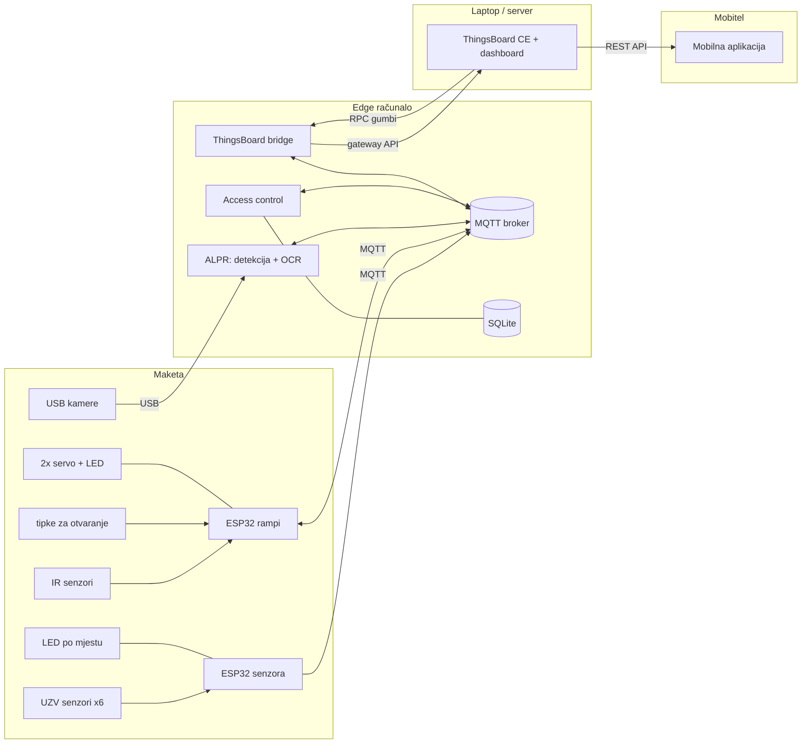
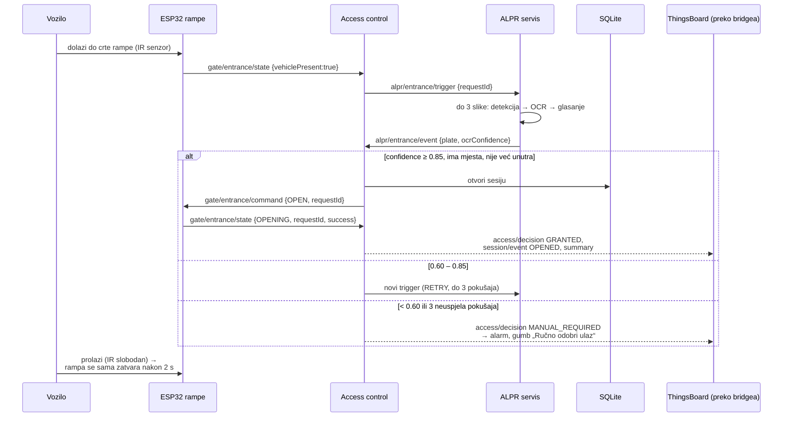
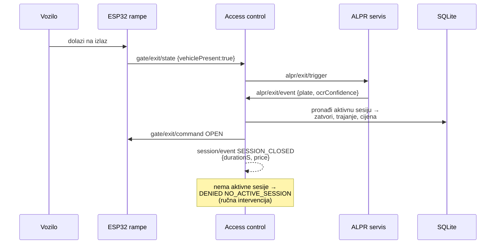

# Arhitektura sustava

Vlasnik dokumenta je Patrik. Promjena koja utječe na više podsustava ide kroz ovaj dokument i
[komunikacijski-ugovor.md](komunikacijski-ugovor.md) te se bilježi u [odluke.md](../upravljanje/odluke.md).

## 1. Minimalni sustav (cilj)

Vozilo dolazi do ulaza → kamera očitava registraciju → edge računalo lokalno odlučuje → rampa se otvara →
senzor mjesta mijenja stanje nakon parkiranja → sve je vidljivo u ThingsBoardu. Na izlazu se registracija
ponovno očitava, izračunava se trajanje i cijena te se zatvara parkirna sesija.

## 2. Blok-dijagram

Ovo je varijanta A: odluke se donose lokalno na edge računalu i sustav radi i bez ThingsBoarda. Jednostavnija
varijanta B, u kojoj sve odluke i podatke preuzima ThingsBoard, opisana je u [varijanta-b.md](varijanta-b.md).

| blok | uloga | tko | kod |
|---|---|---|---|
| UZV senzori, ESP32 senzora, LED | šest senzora iznad mjesta; ESP32 preko Wi-Fi-ja i MQTT-a javlja stanje mjesta, LED ga pokazuje | Toma | `SOFTWARE/senzori` |
| IR senzori, tipke, ESP32 rampi, servo + LED | IR na crti rampe javlja vozilo, tipke ručno otvaraju rampu, dva servo motora pokreću rampe | Luka | `SOFTWARE/rampe` |
| USB kamere, ALPR | detekcija pločice (Sven) i OCR (Lukas) na edge računalu, za ulaz i izlaz | Sven, Lukas | `SOFTWARE/alpr`, `SOFTWARE/edge` |
| Access control, SQLite | odluke o ulasku i izlasku, naredbe rampama, parkirne sesije i naplata | Lukas, Luka (pravila), Lovro (baza) | `SOFTWARE/edge`, `SOFTWARE/baza` |
| ThingsBoard bridge | šalje podatke ThingsBoardu (MQTT gateway API) i čuva ih dok veza ne radi | Anja | `SOFTWARE/thingsboard` |
| ThingsBoard CE | dashboard, alarmi, gumbi za ručno odobravanje (RPC natrag preko bridgea) | Anja, Leo (analitika) | `SOFTWARE/thingsboard` |
| Mobilna aplikacija | čita analitiku iz ThingsBoarda preko REST API-ja | Leo | `SOFTWARE/mobilna-aplikacija` |

Maketu, napajanje, ožičenje i nosače rade Patrik i Lovro (`SOFTWARE/maketa`). Ugovor, integraciju i demonstraciju
vodi Patrik.

Ulazak i izlazak rade lokalno i bez ThingsBoarda. ThingsBoard je digitalni blizanac, nadzor i analitika i nikad
nije jedina komponenta potrebna za otvaranje rampe.

## 3. Tok ulaska

## 4. Tok izlaska

## 5. Raspored (deployment)

| uređaj | što pokreće | kako |
|---|---|---|
| edge računalo | MQTT broker, `edge_service all`, `tb_bridge` | Docker (`SOFTWARE/edge/deploy/docker-compose.edge.yml` + `docker-compose.camera.yml`) ili nativno (`install_native.sh`) |
| laptop (ili drugi uređaj s ≥ 4 GB RAM) | ThingsBoard CE | `SOFTWARE/thingsboard/docker-compose.yml` |
| 2x ESP32 | firmware senzora i rampi | PlatformIO |
| laptop bez hardvera (razvoj) | sve od gore + simulatori | `python SOFTWARE/integracija/simulacija.py --broker` |

Edge računalo može biti bilo koje Linux računalo s Dockerom ili Pythonom ≥ 3.8; odabir je zabilježen u
[odluke.md](../upravljanje/odluke.md) (D-004).

## 6. Što ako podsustav nije dostupan (degradirani rad)

| ispadne | posljedica | ponašanje sustava |
|---|---|---|
| ThingsBoard ili mreža prema njemu | nema dashboarda | ulaz/izlaz rade normalno; bridge sprema podatke u `tb-buffer.db` i šalje ih s izvornim vremenom kad se veza vrati (testirano) |
| MQTT broker / edge računalo | nema automatskih odluka | rampe i dalje rade lokalno: tipka za ručno otvaranje, automatsko zatvaranje, sigurnosno ponovno otvaranje |
| ALPR (kamera, OCR) | nema čitanja | 3 pokušaja → `MANUAL_REQUIRED` + alarm; operater odobrava gumbom na dashboardu ili CLI-jem; razlog se bilježi |
| ESP32 senzora | nema stanja mjesta | Last Will → mjesta postaju `UNKNOWN` (nikad "slobodno"), alarm "Uređaj nije dostupan" |
| jedan senzor | jedno mjesto nepoznato | firmware nakon 5 neuspjelih mjerenja javlja `UNKNOWN`/`TIMEOUT`; ne broji se kao slobodno |
| ESP32 rampi | rampa ne potvrđuje | access control ponovi naredbu jednom (isti `requestId`), zatim alarm `GATE_NO_ACK` |
| Wi-Fi | ESP32 offline | ESP32 se sam ponovno spaja (svakih 5 s); stanja se ponovno objavljuju nakon spajanja |

Vrijeme u porukama je UTC ([komunikacijski ugovor](komunikacijski-ugovor.md)); privatnost i sigurnost su opisane u
[06-privatnost-i-sigurnost.md](../dokumentacija/06-privatnost-i-sigurnost.md).
