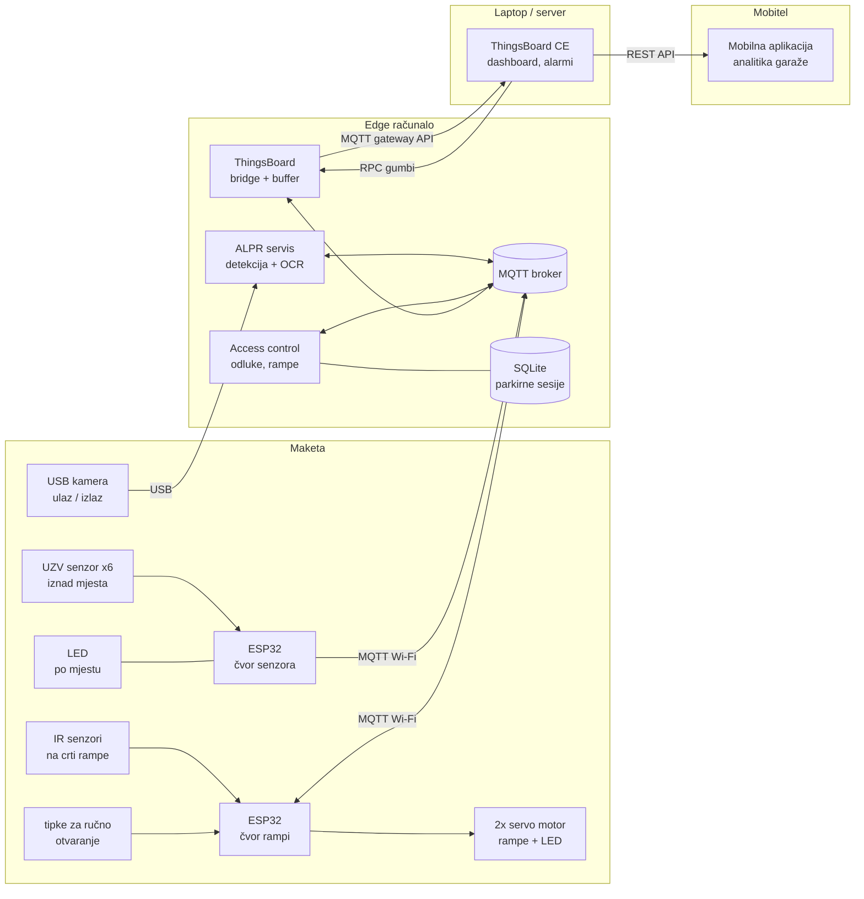
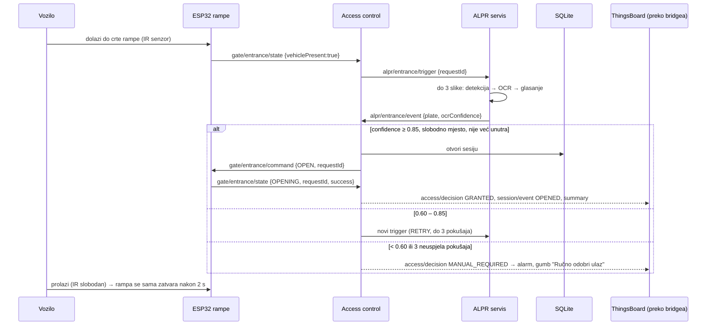
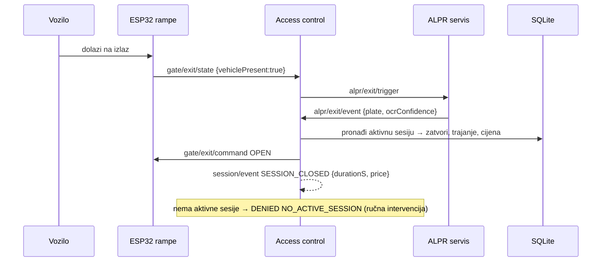

# Arhitektura sustava

> Vlasnik dokumenta: **osoba 1**. Svaka promjena koja utječe na više podsustava ide kroz ovaj dokument
> i [komunikacijski-ugovor.md](komunikacijski-ugovor.md) te se bilježi u [odluke.md](../upravljanje/odluke.md).

## 1. Minimalni sustav (cilj)

Vozilo dolazi do ulaza → kamera očitava registraciju → **edge računalo lokalno odlučuje** → rampa se otvara →
senzor mjesta mijenja stanje nakon parkiranja → sve je vidljivo u ThingsBoardu. Na izlazu se registracija
ponovno očitava, izračunava se trajanje i cijena te se zatvara parkirna sesija.

## 2. Blok-dijagram

**Ključna ideja:** ulazak i izlazak rade lokalno i bez ThingsBoarda. ThingsBoard je digitalni blizanac,
nadzor i analitika – nikada jedina komponenta potrebna za otvaranje rampe.

## 3. Komponente i vlasništvo

| komponenta | gdje radi | vlasnik | kod |
|---|---|---|---|
| čvor senzora (ESP32 + 6x UZV senzor + LED) | maketa | osoba 3 | `SOFTWARE/senzori/firmware` |
| čvor rampi (ESP32 + 2x servo motor + 2x IR senzor + LED + tipke) | maketa | osoba 4 | `SOFTWARE/rampe/firmware` |
| maketa, napajanje, ožičenje, nosači | maketa | osoba 2 | `SOFTWARE/maketa` |
| detekcija pločice (OpenCV) | edge | osoba 5 | `SOFTWARE/alpr/plate_detector` |
| OCR + validacija + ALPR servis + access control | edge | osoba 6 | `SOFTWARE/edge` |
| baza sesija, naplata, testovi, dokumentacija | edge | osoba 8 | `SOFTWARE/baza` |
| ThingsBoard, bridge, dashboardi, alarmi | laptop + edge | osoba 7 | `SOFTWARE/thingsboard` |
| ugovor (teme, JSON sheme), integracija, demo | svi | osoba 1 | `PROJEKT/upravljanje` |

## 4. Tok ulaska

## 5. Tok izlaska

## 6. Raspored (deployment)

| uređaj | što pokreće | kako |
|---|---|---|
| edge računalo | MQTT broker, `edge_service all`, `tb_bridge` | Docker (`SOFTWARE/edge/deploy/docker-compose.edge.yml` + `docker-compose.camera.yml`) ili nativno (`install_native.sh`) |
| laptop (ili drugi uređaj s ≥ 4 GB RAM) | ThingsBoard CE | `SOFTWARE/thingsboard/docker-compose.yml` |
| 2x ESP32 | firmware senzora i rampi | PlatformIO |
| laptop bez hardvera (razvoj) | sve od gore + simulatori | `python SOFTWARE/integracija/simulacija.py --broker` |

Edge računalo može biti bilo koje Linux računalo s Dockerom ili Pythonom ≥ 3.8; odabir je zabilježen u
[odluke.md](../upravljanje/odluke.md) (D-004).

## 7. Što ako podsustav nije dostupan (degradirani rad)

| ispadne | posljedica | ponašanje sustava |
|---|---|---|
| ThingsBoard ili mreža prema njemu | nema dashboarda | ulaz/izlaz rade normalno; bridge sprema podatke u `tb-buffer.db` i šalje ih s izvornim vremenom kad se veza vrati (testirano) |
| MQTT broker / edge računalo | nema automatskih odluka | rampe i dalje rade lokalno: tipka za ručno otvaranje, automatsko zatvaranje, sigurnosno ponovno otvaranje |
| ALPR (kamera, OCR) | nema čitanja | 3 pokušaja → `MANUAL_REQUIRED` + alarm; operater odobrava gumbom na dashboardu ili CLI-jem; razlog se bilježi |
| ESP32 senzora | nema stanja mjesta | Last Will → mjesta postaju `UNKNOWN` (nikad "slobodno"), alarm "Uređaj nije dostupan" |
| jedan senzor | jedno mjesto nepoznato | firmware nakon 5 neuspjelih mjerenja javlja `UNKNOWN`/`TIMEOUT`; ne broji se kao slobodno |
| ESP32 rampi | rampa ne potvrđuje | access control ponovi naredbu jednom (isti `requestId`), zatim alarm `GATE_NO_ACK` |
| Wi-Fi | ESP32 offline | ESP32 se sam ponovno spaja (svakih 5 s); stanja se ponovno objavljuju nakon spajanja |

## 8. Vrijeme, privatnost, sigurnost

- Sva vremena u porukama i bazi: **UTC, ISO 8601** (`2026-10-19T08:31:12Z`); lokalno vrijeme samo u ThingsBoardu.
- Samo **izmišljene registracije** (generator: `SOFTWARE/alpr/tools/generate_plates.py`).
- Slike se ne spremaju; opcionalno samo izrezana pločica (`privacy.save_crops`) uz automatsko brisanje.
- Sesije i događaji brišu se nakon N dana (`parking-sessions purge --days 30`), ThingsBoard čuva telemetriju 30 dana.
- Za završnu demonstraciju: lozinka na MQTT brokeru, tajni token gatewaya, promijenjena lozinka ThingsBoarda.
