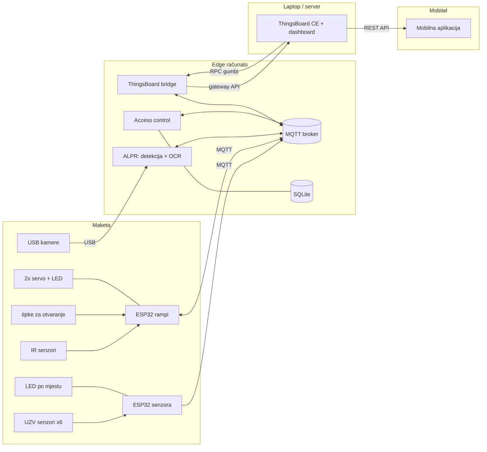
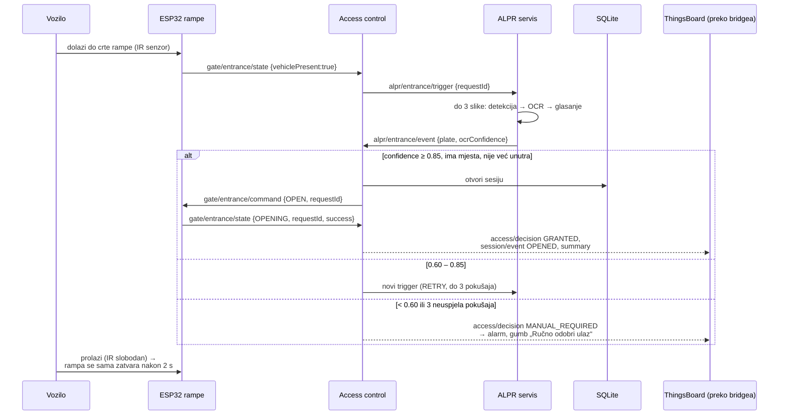
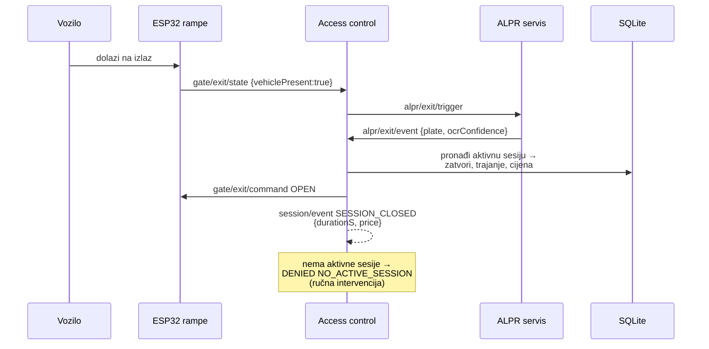
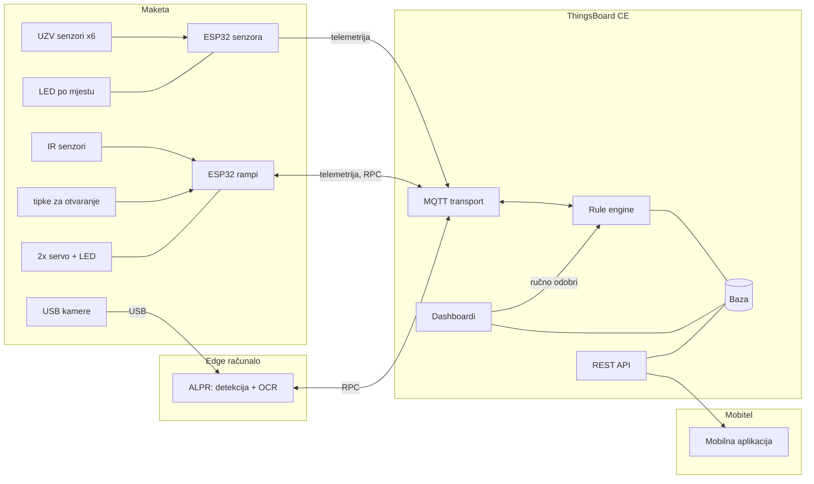
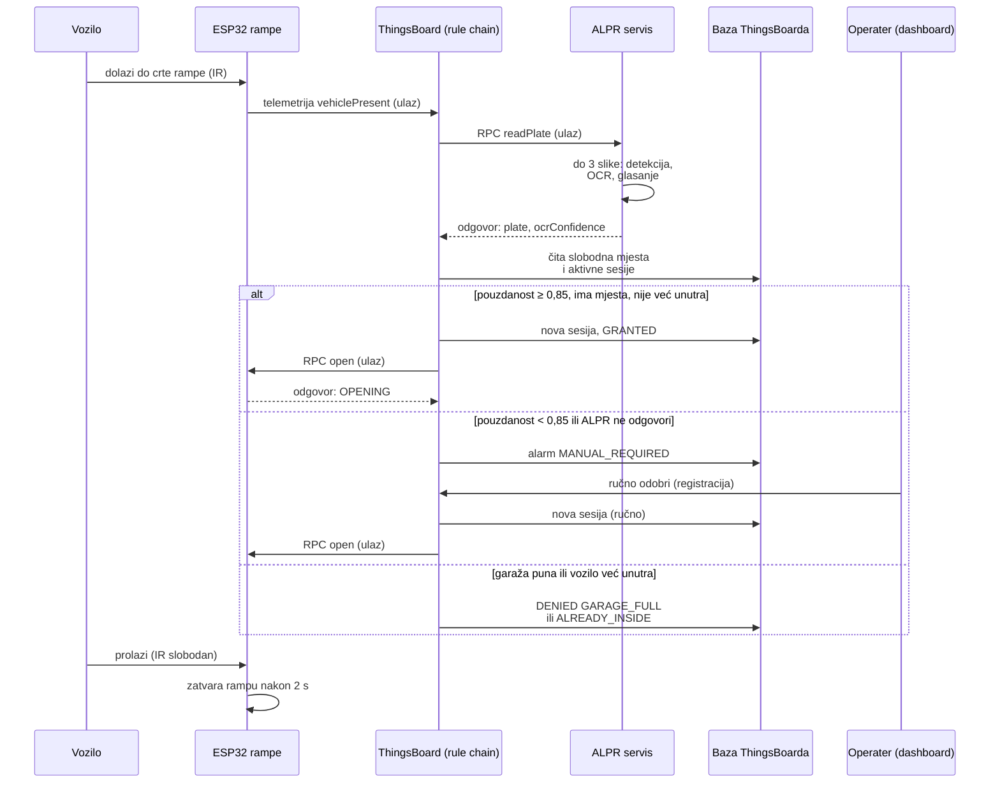
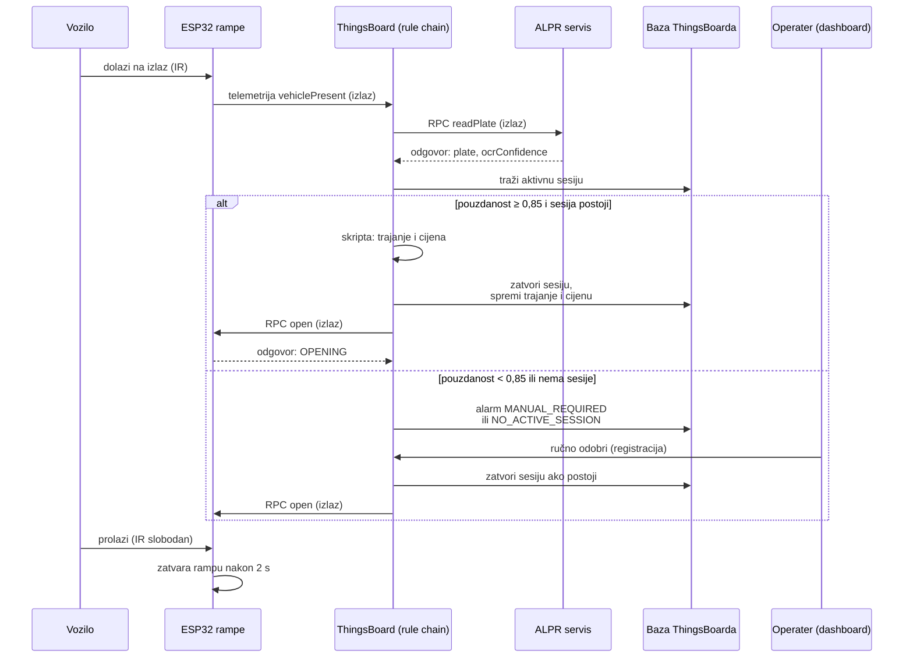

# Arhitektura sustava

> Vlasnik dokumenta: **osoba 1**. Svaka promjena koja utječe na više podsustava ide kroz ovaj dokument
> i [komunikacijski-ugovor.md](komunikacijski-ugovor.md) te se bilježi u [odluke.md](../upravljanje/odluke.md).

## 1. Minimalni sustav (cilj)

Vozilo dolazi do ulaza → kamera očitava registraciju → **edge računalo lokalno odlučuje** → rampa se otvara →
senzor mjesta mijenja stanje nakon parkiranja → sve je vidljivo u ThingsBoardu. Na izlazu se registracija
ponovno očitava, izračunava se trajanje i cijena te se zatvara parkirna sesija.

## 2. Blok-dijagram

Ovo je **varijanta A** – odluke se donose lokalno na edge računalu i sustav radi i bez ThingsBoarda.
Jednostavnija **varijanta B**, u kojoj sve odluke i podatke preuzima ThingsBoard, opisana je u
[poglavlju 9](#9-varijanta-b-sustav-oslonjen-na-thingsboard).

| blok | uloga |
|---|---|
| UZV senzori, ESP32 senzora, LED | šest senzora iznad mjesta; ESP32 preko Wi-Fi-ja i MQTT-a javlja stanje mjesta, LED pokazuje stanje |
| IR senzori, tipke, ESP32 rampi, servo + LED | IR na crti rampe javlja vozilo, tipke ručno otvaraju rampu, dva servo motora pokreću rampe |
| USB kamere, ALPR | detekcija pločice i OCR na edge računalu, za ulaz i izlaz |
| Access control, SQLite | odluke o ulasku i izlasku, naredbe rampama, parkirne sesije i naplata |
| ThingsBoard bridge | šalje podatke ThingsBoardu (MQTT gateway API) i čuva ih dok veza ne radi |
| ThingsBoard CE | dashboard, alarmi, gumbi za ručno odobravanje (RPC natrag preko bridgea) |
| Mobilna aplikacija | čita analitiku iz ThingsBoarda preko REST API-ja |

**Ključna ideja:** ulazak i izlazak rade lokalno i bez ThingsBoarda. ThingsBoard je digitalni blizanac,
nadzor i analitika – nikada jedina komponenta potrebna za otvaranje rampe.

## 3. Komponente i vlasništvo

| komponenta | gdje radi | vlasnik | kod |
|---|---|---|---|
| čvor senzora (ESP32 + 6x UZV senzor + LED) | maketa | osoba 3 | `SOFTWARE/senzori/firmware` |
| čvor rampi (ESP32 + 2x servo motor + 2x IR senzor + LED + tipke) | maketa | osoba 4 | `SOFTWARE/rampe/firmware` |
| maketa, napajanje, ožičenje, nosači | maketa | osoba 2 | `SOFTWARE/maketa` |
| detekcija pločice (OpenCV) | edge | osoba 5 | `SOFTWARE/alpr/plate_detector` |
| OCR + validacija + ALPR servis + access control | edge | osoba 6 | `SOFTWARE/edge` |
| baza sesija, naplata, testovi, dokumentacija | edge | osoba 8 | `SOFTWARE/baza` |
| ThingsBoard, bridge, dashboardi, alarmi | laptop + edge | osoba 7 | `SOFTWARE/thingsboard` |
| ugovor (teme, JSON sheme), integracija, demo | svi | osoba 1 | `PROJEKT/upravljanje` |

## 4. Tok ulaska

## 5. Tok izlaska

## 6. Raspored (deployment)

| uređaj | što pokreće | kako |
|---|---|---|
| edge računalo | MQTT broker, `edge_service all`, `tb_bridge` | Docker (`SOFTWARE/edge/deploy/docker-compose.edge.yml` + `docker-compose.camera.yml`) ili nativno (`install_native.sh`) |
| laptop (ili drugi uređaj s ≥ 4 GB RAM) | ThingsBoard CE | `SOFTWARE/thingsboard/docker-compose.yml` |
| 2x ESP32 | firmware senzora i rampi | PlatformIO |
| laptop bez hardvera (razvoj) | sve od gore + simulatori | `python SOFTWARE/integracija/simulacija.py --broker` |

Edge računalo može biti bilo koje Linux računalo s Dockerom ili Pythonom ≥ 3.8; odabir je zabilježen u
[odluke.md](../upravljanje/odluke.md) (D-004).

## 7. Što ako podsustav nije dostupan (degradirani rad)

| ispadne | posljedica | ponašanje sustava |
|---|---|---|
| ThingsBoard ili mreža prema njemu | nema dashboarda | ulaz/izlaz rade normalno; bridge sprema podatke u `tb-buffer.db` i šalje ih s izvornim vremenom kad se veza vrati (testirano) |
| MQTT broker / edge računalo | nema automatskih odluka | rampe i dalje rade lokalno: tipka za ručno otvaranje, automatsko zatvaranje, sigurnosno ponovno otvaranje |
| ALPR (kamera, OCR) | nema čitanja | 3 pokušaja → `MANUAL_REQUIRED` + alarm; operater odobrava gumbom na dashboardu ili CLI-jem; razlog se bilježi |
| ESP32 senzora | nema stanja mjesta | Last Will → mjesta postaju `UNKNOWN` (nikad "slobodno"), alarm "Uređaj nije dostupan" |
| jedan senzor | jedno mjesto nepoznato | firmware nakon 5 neuspjelih mjerenja javlja `UNKNOWN`/`TIMEOUT`; ne broji se kao slobodno |
| ESP32 rampi | rampa ne potvrđuje | access control ponovi naredbu jednom (isti `requestId`), zatim alarm `GATE_NO_ACK` |
| Wi-Fi | ESP32 offline | ESP32 se sam ponovno spaja (svakih 5 s); stanja se ponovno objavljuju nakon spajanja |

## 8. Vrijeme, privatnost, sigurnost

- Sva vremena u porukama i bazi: **UTC, ISO 8601** (`2026-10-19T08:31:12Z`); lokalno vrijeme samo u ThingsBoardu.
- Samo **izmišljene registracije** (generator: `SOFTWARE/alpr/tools/generate_plates.py`).
- Slike se ne spremaju; opcionalno samo izrezana pločica (`privacy.save_crops`) uz automatsko brisanje.
- Sesije i događaji brišu se nakon N dana (`parking-sessions purge --days 30`), ThingsBoard čuva telemetriju 30 dana.
- Za završnu demonstraciju: lozinka na MQTT brokeru, tajni token gatewaya, promijenjena lozinka ThingsBoarda.

## 9. Varijanta B: sustav oslonjen na ThingsBoard

Ako sustav ne mora raditi bez ThingsBoarda, edge računalo se svodi na ALPR, a lokalni MQTT broker i SQLite baza
nisu potrebni – njihov posao preuzima ThingsBoard (provjereno u dokumentaciji ThingsBoarda):

- **MQTT broker** – ThingsBoard ima ugrađeni MQTT transport (*„ThingsBoard server nodes acts as an MQTT broker“*,
  port 1883, prijava *access tokenom* uređaja). Uređaj šalje telemetriju na `v1/devices/me/telemetry`, atribute na
  `v1/devices/me/attributes`, a naredbe prima na `v1/devices/me/rpc/request/+`
  ([MQTT Device API](https://thingsboard.io/docs/reference/mqtt-api/)).
- **Baza** – telemetrija i atributi spremaju se u bazu ThingsBoarda (PostgreSQL); parkirne sesije postaju atributi i
  telemetrija asseta „Garaža“ ([telemetrija](https://thingsboard.io/docs/user-guide/telemetry/),
  [atributi](https://thingsboard.io/docs/user-guide/attributes/)).
- **Logika** (odluke o ulasku/izlasku, naplata, alarmi) – *rule chain* od standardnih čvorova: *script* (TBEL ili
  JavaScript), *script filter*, *originator attributes* / *related entity data*, *change originator*,
  [*rpc call request*](https://thingsboard.io/docs/user-guide/rule-engine-2-0/nodes/action/rpc-call-request/),
  *save timeseries*, *save attributes*, *create alarm*. Naredbe uređajima idu kao server-side
  [RPC](https://thingsboard.io/docs/user-guide/rpc/); dvosmjerni RPC vraća odgovor uređaja u rule chain.
- **Ograničenje:** ugrađeni MQTT nije opći broker – uređaj šalje samo svoje podatke i prima samo svoje RPC naredbe.
  Uređaji ne razgovaraju izravno; sve ide preko rule chaina.
- **Edge računalo** ostaje samo za kameru i ALPR (ThingsBoard ne obrađuje slike). ALPR servis može raditi i na
  istom laptopu kao ThingsBoard.

### 9.1 Blok-dijagram (varijanta B)

| blok | uloga u varijanti B |
|---|---|
| maketa (senzori, ESP32, rampe) | isto kao u varijanti A, ali se oba ESP32 spajaju izravno na ThingsBoard (MQTT, *access token* uređaja); ESP32 senzora šalje i broj slobodnih mjesta |
| ALPR | jedini servis izvan ThingsBoarda: uređaj u ThingsBoardu koji odgovara na RPC `readPlate`; radi na edge računalu ili na laptopu s ThingsBoardom |
| MQTT transport | ugrađeni MQTT ThingsBoarda (port 1883); nije opći broker |
| Rule engine | odluke o ulasku i izlasku, naplata, alarmi, RPC naredbe rampama |
| Baza | telemetrija, atributi i alarmi; parkirne sesije su atributi asseta „Garaža“ |
| Dashboardi | nadzor, alarmi i gumb za ručno odobravanje, koji ide kroz rule engine |
| REST API, mobilna aplikacija | aplikacija samo čita analitiku |

**Ključna ideja:** sve odluke donosi ThingsBoard. Bez ThingsBoarda ili mreže ulaz i izlaz **ne rade automatski** –
rampe se mogu otvoriti samo tipkom na maketi (firmware i dalje sam zatvara rampu i ne spušta je na vozilo).

### 9.2 Tok ulaska (varijanta B)

- **Ručno odobravanje:** gumb na dashboardu šalje rampi RPC `approve` s registracijom koju operater potvrdi ili
  ispravi. Rule chain tu poruku presretne, otvori sesiju i tek onda rampi pošalje `open`. Bez sesije bi isto
  vozilo na izlazu dobilo `NO_ACTIVE_SESSION`.
- Ako ALPR ne odgovori na RPC u zadanom vremenu (*timeout*), rule chain to tretira kao nisku pouzdanost.
- Broj slobodnih mjesta šalje ESP32 senzora; rule chain ga pri svakoj promjeni sprema kao atribut asseta „Garaža“.

### 9.3 Tok izlaska (varijanta B)

- Skripta računa cijenu istim pravilom kao `SOFTWARE/baza`: prvih 15 min besplatno, zatim 1,50 € po započetom
  satu, najviše 15 € po danu.
- Ponovni pokušaji čitanja (pouzdanost 0,60 – 0,85) ostaju unutar ALPR servisa: on uzme do 3 slike i vrati jedan
  rezultat, a rule chain sve ispod 0,85 šalje na ručno odobrenje. Tako je rule chain jednostavniji.

### 9.4 Usporedba varijanti

| | A – lokalno odlučivanje (edge) | B – ThingsBoard |
|---|---|---|
| MQTT broker | na edge računalu | ugrađeni MQTT transport ThingsBoarda |
| parkirne sesije | SQLite na edge računalu | baza ThingsBoarda (atributi i telemetrija asseta „Garaža“) |
| odluke i naplata | Python servis (`SOFTWARE/edge`), pokriven testovima | rule chain (TBEL skripte), uređuje se u web sučelju |
| edge računalo | broker, ALPR, kontrola pristupa, baza, bridge | samo ALPR (kamera) |
| bez ThingsBoarda ili mreže | ulaz i izlaz rade, podaci se šalju naknadno | automatski ulaz i izlaz ne rade, rampe samo tipkom |
| MQTT teme | vlastiti ugovor (`garage/...`, JSON sheme) | API uređaja ThingsBoarda (`v1/devices/me/...`) |
| testiranje | unit i e2e testovi u repozitoriju | ručno u ThingsBoardu; rule chain se izvozi kao JSON u repozitorij |
| vrijeme odziva | lokalno | ovisi o mreži do servera |

### 9.5 Što bi se promijenilo ako tim odabere varijantu B

- **Firmware** oba ESP32: MQTT host je ThingsBoard, korisničko ime je *access token* uređaja, teme
  `v1/devices/me/telemetry` i `v1/devices/me/rpc/request/+` umjesto `garage/...`; čvor senzora šalje i broj
  slobodnih mjesta.
- **ALPR servis** postaje uređaj u ThingsBoardu koji odgovara na RPC `readPlate`.
- **Dashboard** dobiva gumb za ručno odobravanje (RPC `approve` s registracijom) koji obrađuje rule chain.
- **Kontrola pristupa** (`SOFTWARE/edge/edge_service`), **baza** (`SOFTWARE/baza`) i **bridge** (`tb_bridge`) se ne
  koriste; njihova pravila (pragovi, naplata, allow-lista) prelaze u rule chain, koji se izvozi u
  `SOFTWARE/thingsboard/`.
- Odluku o varijanti zabilježiti u [odluke.md](../upravljanje/odluke.md).
