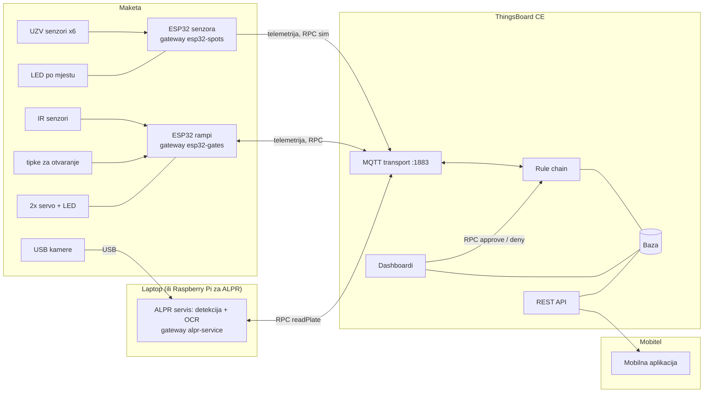
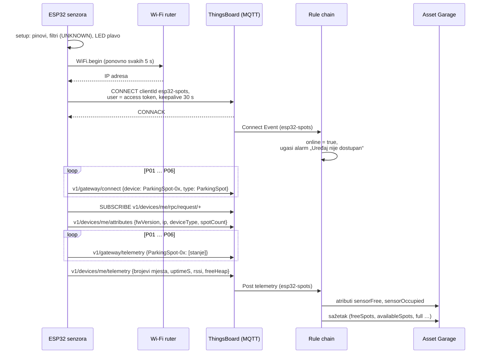
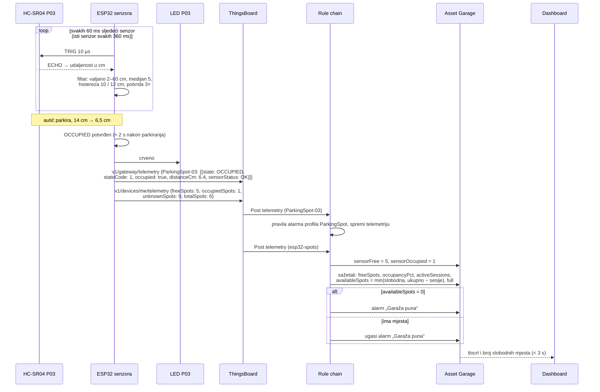
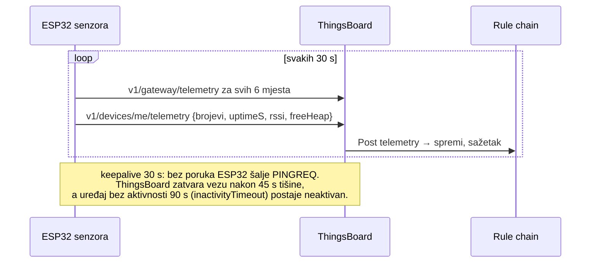
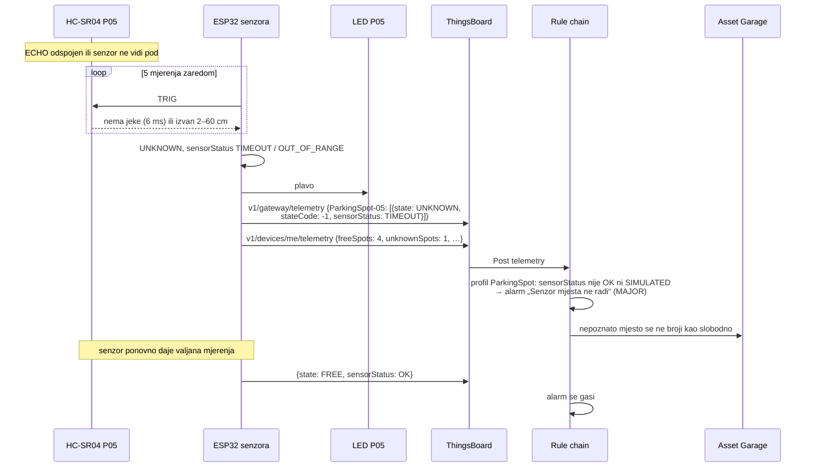
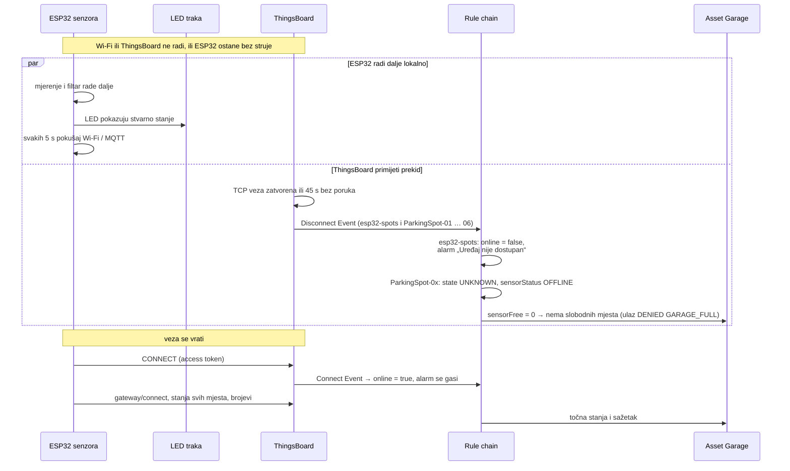
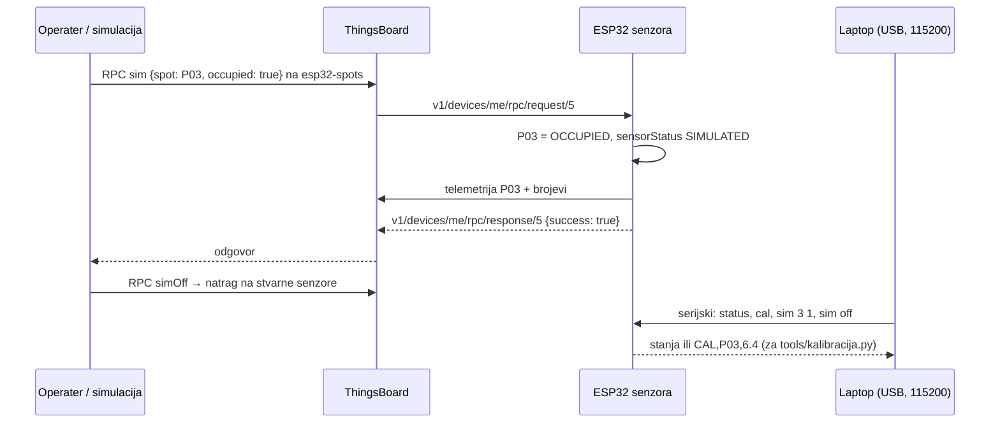
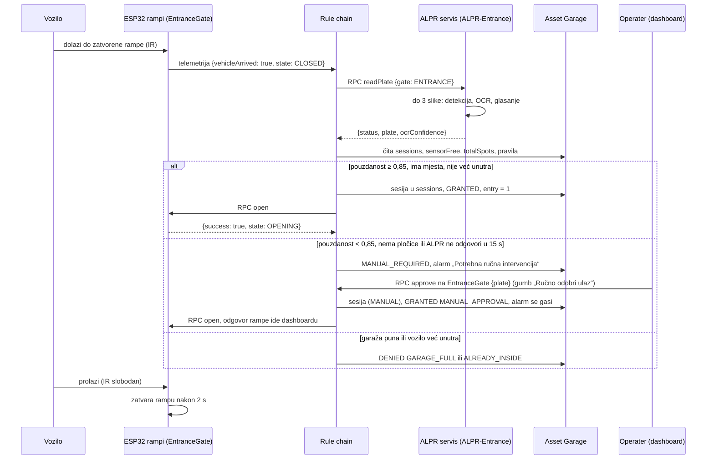
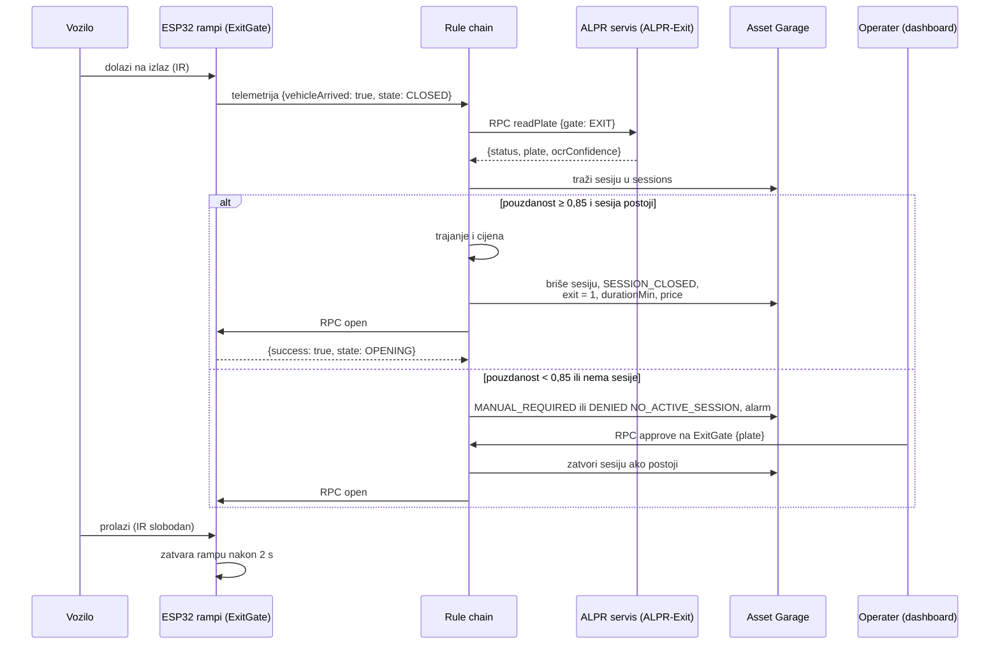

# Varijanta B: sustav oslonjen na ThingsBoard

**Odabrana arhitektura** ([odluka D-012](../upravljanje/odluke.md)). Sav novi rad se radi za varijantu B.
[Varijanta A](arhitektura.md) (lokalno odlučivanje na edge računalu) ostaje u repozitoriju kao rezerva.

Uređaji se spajaju izravno na ThingsBoard, a odluke, parkirne sesije, naplatu i alarme vodi *rule chain*.
Lokalni MQTT broker, SQLite baza, access control na edge računalu i bridge nisu potrebni. Izvan ThingsBoarda
ostaje samo ALPR, jer ThingsBoard ne obrađuje slike.

- MQTT: ugrađeni MQTT transport ThingsBoarda (port 1883, korisničko ime je *access token* uređaja). Svaki čvor je
  *gateway* uređaj ([Gateway MQTT API](https://thingsboard.io/docs/reference/gateway-mqtt-api/), radi u CE) i
  jednom vezom šalje podatke za svoje uređaje.
- Baza: telemetrija, atributi i alarmi u bazi ThingsBoarda (PostgreSQL). Parkirne sesije su atribut `sessions`
  asseta „Garage“, a odluke i završene sesije njegova telemetrija.
- Logika: rule chain [`SOFTWARE/thingsboard/rulechain`](../../SOFTWARE/thingsboard/rulechain) (TBEL skripte +
  generator). Naredbe uređajima su server-side [RPC](https://thingsboard.io/docs/user-guide/rpc/).
- Ugrađeni MQTT nije opći broker: uređaji ne razgovaraju izravno, sve ide preko rule chaina.

Sve je isprobano na ThingsBoard CE 4.2.1 sa simuliranim uređajima (`integracija/simulacija_b.py`, testovi u
[§ Testiranje](#testiranje)); na hardveru još nije.

## Blok-dijagram

| blok | uloga | ThingsBoard | tko | kod |
|---|---|---|---|---|
| ESP32 senzora + 6× HC-SR04 + LED | mjeri zauzetost, šalje stanja mjesta i broj slobodnih | gateway `esp32-spots` → `ParkingSpot-01…06` | Toma | `SOFTWARE/senzori` |
| ESP32 rampi + servo, IR, tipke | izvršava naredbe, javlja dolazak vozila, sam zatvara rampu i ne spušta je na vozilo | gateway `esp32-gates` → `EntranceGate`, `ExitGate` | Luka | `SOFTWARE/rampe` |
| ALPR servis + USB kamere | na RPC `readPlate` vraća registraciju i pouzdanost | gateway `alpr-service` → `ALPR-Entrance`, `ALPR-Exit` | Sven, Lukas | `SOFTWARE/alpr`, `SOFTWARE/edge` (`tb_alpr.py`) |
| rule chain | odluke o ulasku i izlasku, sesije, naplata, alarmi, RPC naredbe rampama | root rule chain „Garaža (varijanta B)“ | Anja, Luka (pravila), Lovro (sesije, naplata) | `SOFTWARE/thingsboard/rulechain` |
| asset „Garage“ | postavke (pragovi, naplata, politika), sesije, sažetak, odluke | asset `Garage` | Anja | `SOFTWARE/thingsboard/provision` |
| dashboardi | nadzor, alarmi, ručno odobravanje, analitika | 2 dashboarda | Anja, Leo | `SOFTWARE/thingsboard/dashboards` |
| mobilna aplikacija | čita analitiku preko REST API-ja | – | Leo | `SOFTWARE/mobilna-aplikacija` |

Sve odluke donosi ThingsBoard. Bez ThingsBoarda ili mreže ulaz i izlaz ne rade automatski, a rampe se mogu
otvoriti samo tipkom na maketi. Firmware i dalje sam zatvara rampu i ne spušta je na vozilo.

## Čvor senzora mjesta (ESP32)

Firmware: [`SOFTWARE/senzori/firmware`](../../SOFTWARE/senzori/firmware), simulator istog ponašanja:
[`spot_simulator_tb.py`](../../SOFTWARE/senzori/simulator/spot_simulator_tb.py).

| smjer | tema | sadržaj | kada |
|---|---|---|---|
| ESP32 → TB | `v1/gateway/connect` | `{"device": "ParkingSpot-03", "type": "ParkingSpot"}` | nakon svakog spajanja, za svako mjesto |
| ESP32 → TB | `v1/gateway/telemetry` | `{"ParkingSpot-03": [{"state": "OCCUPIED", "stateCode": 1, "occupied": true, "distanceCm": 6.4, "sensorStatus": "OK"}]}` | promjena, svakih 30 s, nakon spajanja |
| ESP32 → TB | `v1/devices/me/telemetry` | `{"freeSpots": 5, "occupiedSpots": 1, "unknownSpots": 0, "totalSpots": 6}` (+ `uptimeS`, `rssi`, `freeHeap` svakih 30 s) | uz svaku promjenu, svakih 30 s |
| ESP32 → TB | `v1/devices/me/attributes` | `{"fwVersion", "ip", "deviceType", "spotCount"}` | nakon spajanja |
| TB → ESP32 | `v1/devices/me/rpc/request/+` | `sim {"spot": "P03", "occupied": true\|false\|null}`, `simOff`, `status` | simulacija, provjera |

Vrijeme poruka postavlja ThingsBoard (vrijeme primitka), pa ESP32 ne treba NTP. `state` je `FREE | OCCUPIED |
UNKNOWN`, `stateCode` 0 / 1 / −1, a `sensorStatus` `OK | TIMEOUT | OUT_OF_RANGE | SIMULATED` (`OFFLINE`
postavlja rule chain kad čvor nestane). Za `UNKNOWN` nema ključeva `occupied` i `distanceCm`.

### Pokretanje i spajanje

Dok se filtar ne napuni (prvih ≈ 2 s), mjesta su `UNKNOWN` i ne broje se kao slobodna.

### Parkiranje: mjerenje i promjena stanja

Odlazak s mjesta je isti tok: 6,5 cm → 14 cm, `FREE`, zeleno. Vrijednost između pragova (10–12 cm) ne mijenja
stanje (histereza), pa mjesto ne treperi.

### Periodično javljanje

### Kvar senzora

### Gubitak veze i oporavak

Prekid se vidi u ThingsBoardu za najviše ≈ 45 s (odmah ako se TCP veza uredno zatvori). Isprobano u simulaciji
(korak 8 scenarija).

### Simulacija i kalibracija

`occupied: null` simulira pokvaren senzor (`TIMEOUT`), pa se može isprobati i alarm.

## Tok ulaska

- Ručno odobravanje: gumb šalje rampi RPC `approve`. Rule chain ga presretne, uzme registraciju iz parametra,
  iz polja „Registracija za ručno odobrenje“ (atribut `manualPlate`) ili zadnju očitanu, otvori sesiju i tek onda
  rampi pošalje `open`. Bez sesije bi isto vozilo na izlazu dobilo `NO_ACTIVE_SESSION`. Gumb „Odbij“ (RPC `deny`)
  bilježi `DENIED MANUAL_DENIAL`, a rampa kratko zapišti.
- Ponovni pokušaji čitanja (pouzdanost 0,60–0,85) ostaju unutar ALPR servisa, koji uzme do 3 slike i vrati jedan
  rezultat. Rule chain sve ispod 0,85 šalje operateru, pa se rampa nikad ne otvori sama ispod praga.
- Rampa mora potvrditi naredbu u 5 s, inače alarm „Rampa ne potvrđuje naredbe“.

## Tok izlaska

Cijena se računa istim [pravilom naplate](model-podataka.md#pravilo-naplate) kao `SOFTWARE/baza`; postavke su
atributi asseta „Garage“ (`freeMinutes`, `pricePerHourCents`, `dailyCapCents`, `timeMultiplier`; demo:
`provision.py --demo-pricing`). S `exitFuzzyMatch = true` izlaz prihvaća jedan pogrešno pročitan znak ako
odgovara točno jedna sesija.

## Rule chain

Izvor su TBEL skripte u [`rulechain/scripts`](../../SOFTWARE/thingsboard/rulechain/scripts) i generator
[`build_rule_chain.py`](../../SOFTWARE/thingsboard/rulechain/build_rule_chain.py), koji piše `garaza.json`.
`provision.py` ga uveze i postavi kao *root* rule chain. Promjene u web sučelju se gube pri sljedećem
`provision.py`, pa ih treba prenijeti u skripte.

Redoslijed: profili uređaja šalju poruke u red `SequentialByOriginator` (poruke jednog uređaja jedna za drugom), a
nakon „Na asset Garage“ *checkpoint* ih vrati u isti red s assetom kao pošiljateljem. Tako se brojevi mjesta, sesije
i sažetak mijenjaju jedan po jedan, i kad ulaz i izlaz odlučuju u istom trenutku. U zadanom redu `Main` poruke se
obrađuju paralelno, pa bi stariji broj slobodnih mjesta mogao prepisati noviji (uočeno u testu).

| poruka | što rule chain napravi |
|---|---|
| bilo koja telemetrija ili atribut uređaja | pravila alarma profila, spremanje |
| `esp32-spots`: `freeSpots`, `occupiedSpots` | atributi `sensorFree`, `sensorOccupied` asseta Garage → sažetak, alarm „Garaža puna“ |
| rampa: `vehicleArrived: true` | RPC `readPlate` ALPR uređaju te rampe (15 s) → odluka (`decide.tbel`) → sesija, telemetrija odluke, RPC `open` rampi, alarm „Potrebna ručna intervencija“ |
| RPC `approve` / `deny` s dashboarda na rampu | ista odluka kao ručna radnja; rampa odgovara dashboardu |
| RPC `open`, `close`, `reset` s dashboarda | ravno rampi |
| Connect / Disconnect / Inactivity Event | `online`, alarm „Uređaj nije dostupan“; mjesta `UNKNOWN` / `OFFLINE`; bez čvora senzora nema slobodnih mjesta |
| rampa ne odgovori na naredbu u 5 s | `ackTimeout`, alarm „Rampa ne potvrđuje naredbe“ |

Entiteti, ključevi telemetrije, atributi asseta i alarmi: [entiteti-i-alarmi.md](entiteti-i-alarmi.md).
Teme i poruke svih uređaja: [komunikacijski ugovor](komunikacijski-ugovor.md).

## Raspored (deployment)

| uređaj | što pokreće | kako |
|---|---|---|
| laptop (≥ 4 GB RAM) | ThingsBoard CE, rule chain, dashboardi | `SOFTWARE/thingsboard/docker-compose.yml` + `provision/provision.py` |
| laptop ili Raspberry Pi uz kameru | ALPR servis | `python -m edge_service --config edge.yaml tb-alpr` |
| 2× ESP32 | firmware senzora i rampi | PlatformIO, `secrets.h`: Wi-Fi, IP laptopa, *access token* |
| laptop bez hardvera (razvoj) | ThingsBoard + simulirani uređaji | `python integracija/simulacija_b.py` |

## Degradirani rad

| ispadne | ponašanje |
|---|---|
| ThingsBoard ili mreža | nema automatskih odluka: rampe se otvaraju samo tipkom, same se zatvaraju i ne spuštaju se na vozilo; LED mjesta rade; nakon povratka čvorovi pošalju sva stanja |
| ALPR (kamera, OCR) | RPC `readPlate` ne odgovori u 15 s → `MANUAL_REQUIRED` + alarm; operater odobrava na dashboardu |
| ESP32 senzora | Disconnect → mjesta `UNKNOWN` / `OFFLINE` (nikad „slobodno“), alarm „Uređaj nije dostupan“ |
| jedan senzor | nakon 5 neuspjelih mjerenja `UNKNOWN` / `TIMEOUT`, alarm „Senzor mjesta ne radi“ |
| ESP32 rampi | RPC `open` bez odgovora u 5 s → alarm „Rampa ne potvrđuje naredbe“ |
| Wi-Fi | ESP32 se sam ponovno spaja (svakih 5 s) i ponovno pošalje sva stanja |

## Testiranje

| što | kako | gdje |
|---|---|---|
| rule chain sa simuliranim uređajima: ulaz, ručno odobrenje, već unutra, izlaz s cijenom, nepoznato vozilo, puna garaža, gubitak čvora senzora; `decide.tbel`: nikad otvaranje ispod praga, allow-lista, cijena = Python pravilo | `python integracija/simulacija_b.py` ili `TB_LIVE_TEST=1 pytest integracija/tests/test_varijanta_b.py` | CI (ThingsBoard u Dockeru); lokalno treba ThingsBoard + `provision.py` |
| isto s pravim ALPR-om i OCR-om na sintetskim slikama | `python integracija/simulacija_b.py --alpr sim` | treba Tesseract |
| `garaza.json` odgovara skriptama, svi čvorovi su povezani | `pytest thingsboard/tests` | CI |
| ALPR kao uređaj ThingsBoarda | `pytest edge/tests/test_tb_alpr.py` | CI |
| firmware oba ESP32 | `pio test -e native`, `pio run` | CI |

## Usporedba s varijantom A

| | A – lokalno odlučivanje (edge) | B – ThingsBoard (odabrano) |
|---|---|---|
| MQTT broker | Mosquitto na edge računalu | ugrađeni MQTT transport ThingsBoarda |
| parkirne sesije | SQLite na edge računalu | atribut `sessions` asseta Garage |
| odluke i naplata | Python servis (`SOFTWARE/edge`) | rule chain (TBEL skripte u repozitoriju) |
| edge računalo | broker, ALPR, kontrola pristupa, baza, bridge | samo ALPR (može i na laptopu) |
| bez ThingsBoarda ili mreže | ulaz i izlaz rade, podaci se šalju naknadno | automatski ulaz i izlaz ne rade, rampe samo tipkom |
| MQTT teme | vlastiti ugovor (`garage/...`, JSON sheme) | API uređaja ThingsBoarda (`v1/gateway/...`, `v1/devices/me/...`) |
| testiranje | unit i e2e testovi bez ThingsBoarda | unit testovi + scenarij na pravom ThingsBoardu |
| vrijeme odziva | lokalno | ovisi o mreži do laptopa |

## Što je napravljeno za prijelaz i što još treba

| | stanje |
|---|---|
| firmware senzora i rampi na ThingsBoard API-ju (gateway, RPC, `vehicleArrived`) | ✅ preveden, unit testovi · ⬜ na hardveru |
| ALPR kao uređaj ThingsBoarda (`edge_service tb-alpr`) | ✅ isprobano sa sintetskim slikama · ⬜ s kamerom |
| rule chain, provisioning (gateway uređaji, tokeni, postavke asseta), dashboardi | ✅ isprobano na ThingsBoard CE 4.2.1 |
| simulatori i scenarij za B | ✅ |
| access control (`SOFTWARE/edge/edge_service`), baza (`SOFTWARE/baza`), bridge (`tb_bridge`), Mosquitto | ostaju kao varijanta A (rezerva), ne koriste se |
| ⬜ tajni *access tokeni* i lozinka tenanta za demonstraciju | Anja |
| ⬜ cijeli [plan integracije](../upravljanje/plan-integracije.md) s hardverom | svi |
