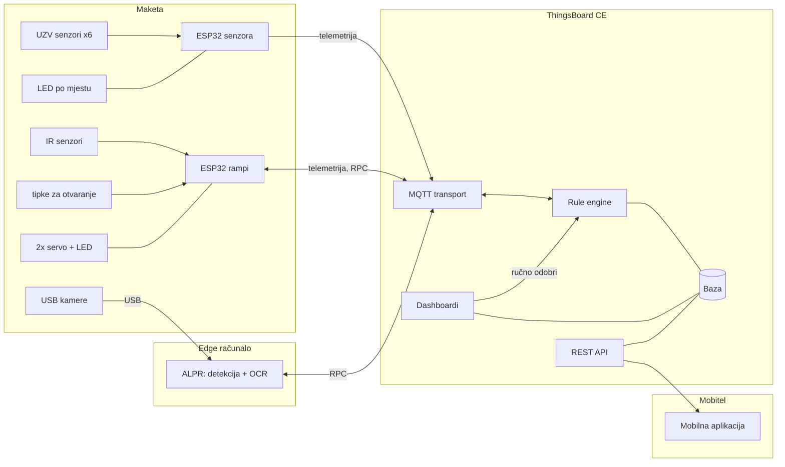
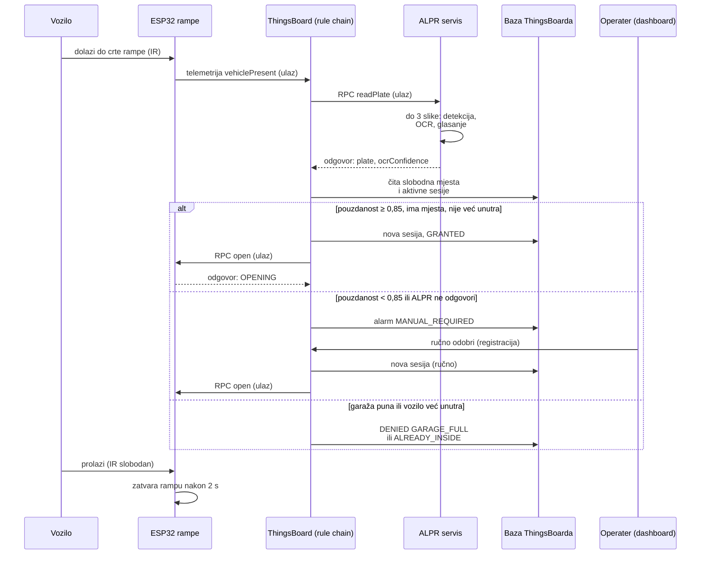
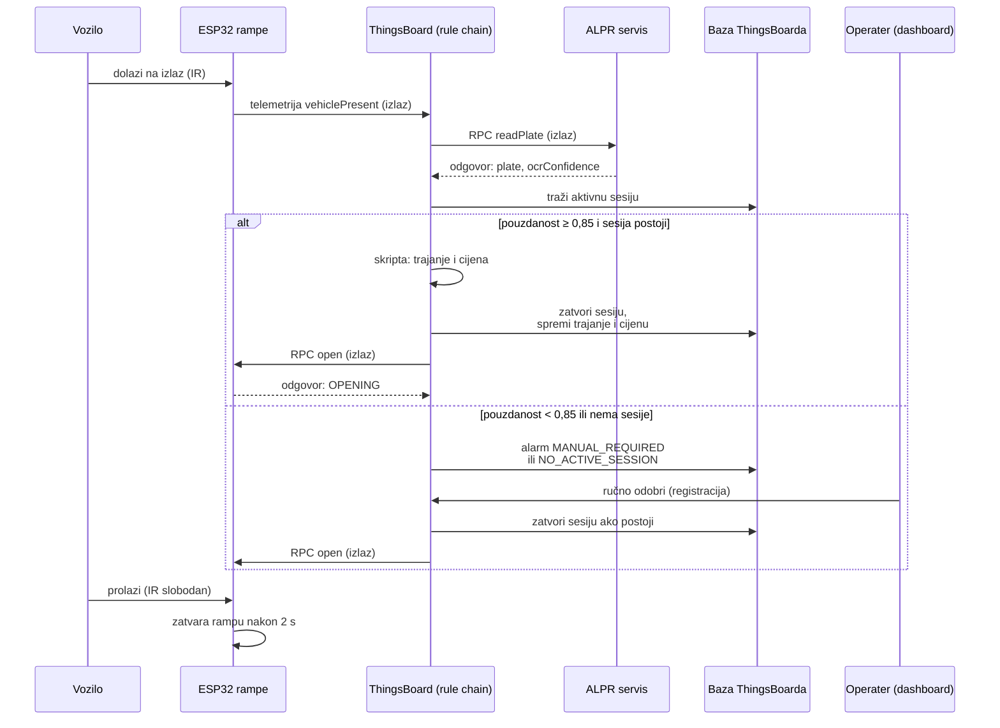

# Varijanta B: sustav oslonjen na ThingsBoard

Jednostavnija alternativa [varijanti A](arhitektura.md), koja je napisana u kodu. Ako sustav ne mora raditi bez
ThingsBoarda, edge računalo se svodi na ALPR, a lokalni MQTT broker i SQLite baza nisu potrebni. Njihov posao
preuzima ThingsBoard (provjereno u dokumentaciji ThingsBoarda):

- MQTT broker: ThingsBoard ima ugrađeni MQTT transport (*„ThingsBoard server nodes acts as an MQTT broker“*,
  port 1883, prijava *access tokenom* uređaja). Uređaj šalje telemetriju na `v1/devices/me/telemetry`, atribute na
  `v1/devices/me/attributes`, a naredbe prima na `v1/devices/me/rpc/request/+`
  ([MQTT Device API](https://thingsboard.io/docs/reference/mqtt-api/)).
- Baza: telemetrija i atributi spremaju se u bazu ThingsBoarda (PostgreSQL); parkirne sesije postaju atributi i
  telemetrija asseta „Garaža“ ([telemetrija](https://thingsboard.io/docs/user-guide/telemetry/),
  [atributi](https://thingsboard.io/docs/user-guide/attributes/)).
- Logika (odluke o ulasku i izlasku, naplata, alarmi): *rule chain* od standardnih čvorova: *script* (TBEL ili
  JavaScript), *script filter*, *originator attributes* / *related entity data*, *change originator*,
  [*rpc call request*](https://thingsboard.io/docs/user-guide/rule-engine-2-0/nodes/action/rpc-call-request/),
  *save timeseries*, *save attributes*, *create alarm*. Naredbe uređajima idu kao server-side
  [RPC](https://thingsboard.io/docs/user-guide/rpc/); dvosmjerni RPC vraća odgovor uređaja u rule chain.
- Ograničenje: ugrađeni MQTT nije opći broker. Uređaj šalje samo svoje podatke i prima samo svoje RPC naredbe.
  Uređaji ne razgovaraju izravno; sve ide preko rule chaina.
- Edge računalo ostaje samo za kameru i ALPR (ThingsBoard ne obrađuje slike). ALPR servis može raditi i na
  istom laptopu kao ThingsBoard.

## Blok-dijagram

| blok | uloga u varijanti B |
|---|---|
| maketa (senzori, ESP32, rampe) | isto kao u varijanti A, ali se oba ESP32 spajaju izravno na ThingsBoard (MQTT, *access token* uređaja); ESP32 senzora šalje i broj slobodnih mjesta |
| ALPR | jedini servis izvan ThingsBoarda: uređaj u ThingsBoardu koji odgovara na RPC `readPlate`; radi na edge računalu ili na laptopu s ThingsBoardom |
| MQTT transport | ugrađeni MQTT ThingsBoarda (port 1883); nije opći broker |
| Rule engine | odluke o ulasku i izlasku, naplata, alarmi, RPC naredbe rampama |
| Baza | telemetrija, atributi i alarmi; parkirne sesije su atributi asseta „Garaža“ |
| Dashboardi | nadzor, alarmi i gumb za ručno odobravanje, koji ide kroz rule engine |
| REST API, mobilna aplikacija | aplikacija samo čita analitiku |

Sve odluke donosi ThingsBoard. Bez ThingsBoarda ili mreže ulaz i izlaz ne rade automatski, a rampe se mogu
otvoriti samo tipkom na maketi. Firmware i dalje sam zatvara rampu i ne spušta je na vozilo.

## Tok ulaska

- Ručno odobravanje: gumb na dashboardu šalje rampi RPC `approve` s registracijom koju operater potvrdi ili
  ispravi. Rule chain tu poruku presretne, otvori sesiju i tek onda rampi pošalje `open`. Bez sesije bi isto
  vozilo na izlazu dobilo `NO_ACTIVE_SESSION`.
- Ako ALPR ne odgovori na RPC u zadanom vremenu (*timeout*), rule chain to tretira kao nisku pouzdanost.
- Broj slobodnih mjesta šalje ESP32 senzora; rule chain ga pri svakoj promjeni sprema kao atribut asseta „Garaža“.

## Tok izlaska

- Skripta računa cijenu istim [pravilom naplate](model-podataka.md#pravilo-naplate) kao `SOFTWARE/baza`.
- Ponovni pokušaji čitanja (pouzdanost 0,60–0,85) ostaju unutar ALPR servisa, koji uzme do 3 slike i vrati jedan
  rezultat. Rule chain sve ispod 0,85 šalje na ručno odobrenje, pa je jednostavniji.

## Usporedba s varijantom A

| | A – lokalno odlučivanje (edge) | B – ThingsBoard |
|---|---|---|
| MQTT broker | na edge računalu | ugrađeni MQTT transport ThingsBoarda |
| parkirne sesije | SQLite na edge računalu | baza ThingsBoarda (atributi i telemetrija asseta „Garaža“) |
| odluke i naplata | Python servis (`SOFTWARE/edge`), pokriven testovima | rule chain (TBEL skripte), uređuje se u web sučelju |
| edge računalo | broker, ALPR, kontrola pristupa, baza, bridge | samo ALPR (kamera) |
| bez ThingsBoarda ili mreže | ulaz i izlaz rade, podaci se šalju naknadno | automatski ulaz i izlaz ne rade, rampe samo tipkom |
| MQTT teme | vlastiti ugovor (`garage/...`, JSON sheme) | API uređaja ThingsBoarda (`v1/devices/me/...`) |
| testiranje | unit i e2e testovi u repozitoriju | ručno u ThingsBoardu; rule chain se izvozi kao JSON u repozitorij |
| vrijeme odziva | lokalno | ovisi o mreži do servera |

## Što bi se promijenilo ako tim odabere varijantu B

- Firmware oba ESP32: MQTT host je ThingsBoard, korisničko ime je *access token* uređaja, teme
  `v1/devices/me/telemetry` i `v1/devices/me/rpc/request/+` umjesto `garage/...`; čvor senzora šalje i broj
  slobodnih mjesta.
- ALPR servis postaje uređaj u ThingsBoardu koji odgovara na RPC `readPlate`.
- Dashboard dobiva gumb za ručno odobravanje (RPC `approve` s registracijom) koji obrađuje rule chain.
- Kontrola pristupa (`SOFTWARE/edge/edge_service`), baza (`SOFTWARE/baza`) i bridge (`tb_bridge`) se ne
  koriste; njihova pravila (pragovi, naplata, allow-lista) prelaze u rule chain, koji se izvozi u
  `SOFTWARE/thingsboard/`.
Odluku o varijanti treba zabilježiti u [odluke.md](../upravljanje/odluke.md).
