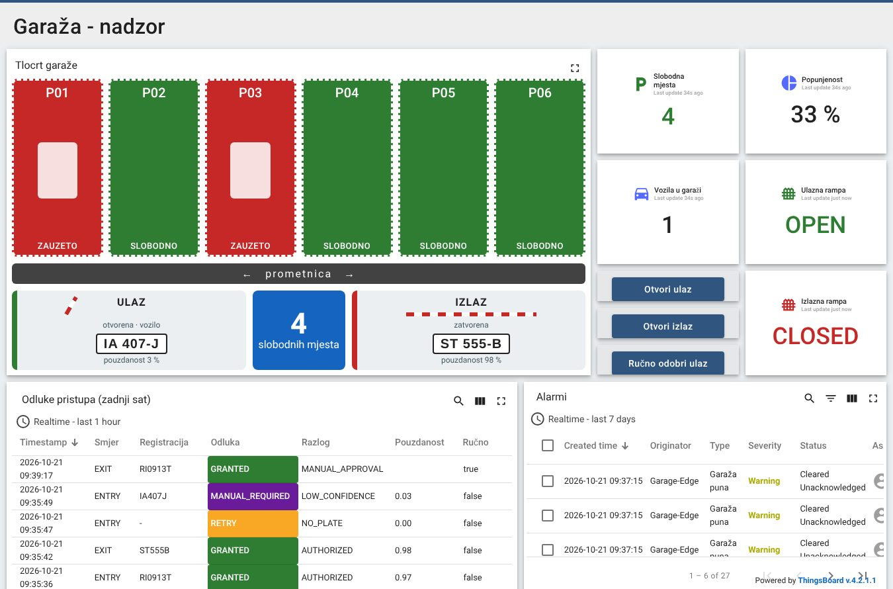
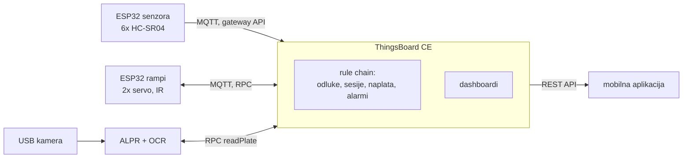

# IoT Garaža

- **Projekt:** IoT Garaža, ak. god. 2026/27
- **Puni naziv projekta:** Pametna parkirna garaža s automatskim prepoznavanjem registarskih oznaka (ALPR),
  lokalnim (edge) upravljanjem ulaskom i izlaskom te digitalnim blizancem u platformi ThingsBoard
- **Trajanje:** 19.10.2026. – 29.1.2027. (rok za predaju)
- **Datum prezentacije:** _upisati_

Pametna garaža na maketi: kamera čita registraciju, ThingsBoard odlučuje o ulasku, rampa se otvara, senzori
prate zauzetost mjesta, parkirna sesija se naplaćuje pri izlasku, a sve se prikazuje u ThingsBoardu i mobilnoj
aplikaciji. Tim radi [varijantu B](PROJEKT/sustav/varijanta-b.md) (odluka D-012): uređaji se spajaju izravno na
ThingsBoard, a odluke vodi njegov rule chain.

## Sadržaj repozitorija

Struktura slijedi [upute nastavnika](OSTALO/upute-nastavnika-gitlab.md); svaka mapa ima `README.md` s opisom.

| mapa | sadržaj |
|---|---|
| [PROJEKT](PROJEKT) | [prijedlog i plan projekta](PROJEKT/plan-projekta) (DOCX + PDF), [završna dokumentacija](PROJEKT/dokumentacija), [arhitektura i komunikacijski ugovor](PROJEKT/sustav), [plan rada, rizici, odluke](PROJEKT/upravljanje), [nacrt makete](PROJEKT/maketa), [testiranje](PROJEKT/testiranje) |
| [SOFTWARE](SOFTWARE) | sav kod – firmware, ALPR, ThingsBoard (rule chain, dashboardi), simulacija, 3D dijelovi; [instalacija](SOFTWARE/INSTALL.md) |
| [PREZENTACIJA](PREZENTACIJA) | [demo scenarij](PREZENTACIJA/demo-scenarij.md), završna prezentacija |
| [OSTALO](OSTALO) | [literatura i poveznice](OSTALO/literatura.md), upute nastavnika |



## Tim

Svaki dio sustava ima svoju mapu s README-om: tko je zadužen, što je već napravljeno, kako se koristi i što još
treba napraviti.

| uloga | tko | mapa |
|---|---|---|
| voditelj, arhitektura, integracija | Patrik | [PROJEKT/upravljanje](PROJEKT/upravljanje) |
| maketa, napajanje, ožičenje | Patrik, Lovro Gale | [SOFTWARE/maketa](SOFTWARE/maketa) |
| senzori mjesta, firmware | Toma Burgund (+ Lovro Gale) | [SOFTWARE/senzori](SOFTWARE/senzori) |
| rampe, aktuatori, pravila odluke | Luka Oslić | [SOFTWARE/rampe](SOFTWARE/rampe) |
| ALPR – detekcija pločice | Sven Matić | [SOFTWARE/alpr](SOFTWARE/alpr) |
| OCR, ALPR servis | Lukas Davorija | [SOFTWARE/edge](SOFTWARE/edge) |
| ThingsBoard, rule chain | Anja, Leo Hreljanović (analitika) | [SOFTWARE/thingsboard](SOFTWARE/thingsboard) |
| sesije i naplata, testovi, GitHub | Lovro Gale | [SOFTWARE/thingsboard/rulechain](SOFTWARE/thingsboard/rulechain) |

<!-- gitlab:izostavi -->
Za voditelja: [vodič za voditelja](PROJEKT/upravljanje/vodic-za-voditelja.md) sa stanjem projekta, pojmovima i
postavljanjem sustava s hardverom.

<!-- /gitlab -->
Leo Hreljanović uz to izrađuje [mobilnu aplikaciju za analitiku garaže](SOFTWARE/mobilna-aplikacija) (zauzetost, ulasci po satu, prosječno trajanje, povijest sesija), koja podatke čita iz ThingsBoarda preko REST API-ja.

<!-- gitlab:od-tjedna=12 -->
Rezultati svih testova (automatskih, u simulaciji i na maketi) vode se u
[testnom zapisniku](PROJEKT/testiranje/testni-zapisnik.md).
<!-- /gitlab -->

## Arhitektura ukratko



Detalji: [varijanta B](PROJEKT/sustav/varijanta-b.md) · [teme i poruke](PROJEKT/sustav/komunikacijski-ugovor.md) ·
[odluke](PROJEKT/upravljanje/odluke.md) · [demo scenarij](PREZENTACIJA/demo-scenarij.md) ·
[varijanta A (rezerva)](PROJEKT/sustav/arhitektura.md)

<!-- gitlab:do-tjedna=7
## Brzi start

```bash
cd SOFTWARE
python -m venv .venv && source .venv/bin/activate        # Windows: .venv\Scripts\activate
pip install -r requirements-dev.txt
pytest
```

Upute za pojedine dijelove sustava su u `README.md` datotekama mapa u [SOFTWARE](SOFTWARE).
-->
<!-- gitlab:od-tjedna=8 -->
## Brzi start – cijeli sustav bez hardvera (10 minuta)

Treba: Python ≥ 3.8, [Docker](https://docs.docker.com/get-docker/) (ThingsBoard) i, za pravi OCR,
[Tesseract](https://tesseract-ocr.github.io/tessdoc/Installation.html) (Linux: `sudo apt install tesseract-ocr`).

```bash
git clone <repo> && cd IoTGarage/SOFTWARE              # sve naredbe se pokreću iz mape SOFTWARE
python -m venv .venv && source .venv/bin/activate        # Windows: .venv\Scripts\activate
pip install -r requirements-dev.txt

docker compose -f thingsboard/docker-compose.yml up -d   # ThingsBoard, prvo pokretanje ~2 min
python thingsboard/provision/provision.py --demo-pricing # uređaji, tokeni, rule chain, dashboardi
python integracija/simulacija_b.py                       # demo: ulaz, ručno odobrenje, izlaz s cijenom, puna garaža, kvar
pytest                                                   # svi testovi
```

Dashboard: http://localhost:8080 (`tenant@thingsboard.org` / `tenant`).

<!-- /gitlab -->
<!-- gitlab:od-tjedna=9 -->
ThingsBoard, firmware, edge računalo i varijable konfiguracije: [SOFTWARE/INSTALL.md](SOFTWARE/INSTALL.md).
<!-- /gitlab -->

## Struktura i pravila

- Python paketi se instaliraju iz svojih mapa (`SOFTWARE/requirements-dev.txt`), firmware je PlatformIO.
- Sva vremena: **UTC ISO 8601**. Sve registracije: **izmišljene**.
- Sav novi rad je za varijantu B ([D-012](PROJEKT/upravljanje/odluke.md)); kod varijante A (`edge_service`
  access control, `SOFTWARE/baza`, `tb_bridge`, Mosquitto) se samo održava.
- Teme, ključeve i RPC metode mijenja samo voditelj ([komunikacijski ugovor](PROJEKT/sustav/komunikacijski-ugovor.md),
  `garage_contract/tb.py`, rule chain).
- Tuđa mapa mijenja se samo uz dogovor s njezinim vlasnikom.
<!-- gitlab:izostavi -->
- Svatko radi u svojoj grani i otvara Pull Request, koji pregledava barem jedna osoba. CI (`.github/workflows/ci.yml`) mora biti zelen:
  Python testovi (3.8 i 3.12), scenarij varijante B u pravom ThingsBoardu (Docker), prevođenje i unit testovi oba
  firmwarea, renderiranje 3D dijelova; e2e simulacija varijante A i dalje se vrti.
- Službeni GitLab repozitorij puni se tjedan po tjedan: [.gitlab-tjedni](.gitlab-tjedni/README.md).
<!-- /gitlab -->
<!-- gitlab:do-tjedna=15
- Prije svakog commita: `pytest` u mapi `SOFTWARE` mora proći.
-->
- Ne komitati: `secrets.h`, `edge.yaml`, `.env`, *access tokene* za demonstraciju, baze `*.db`, stvarne fotografije.
