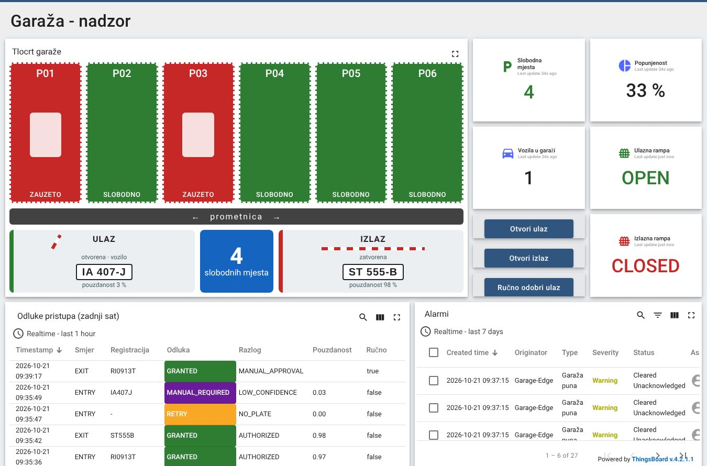
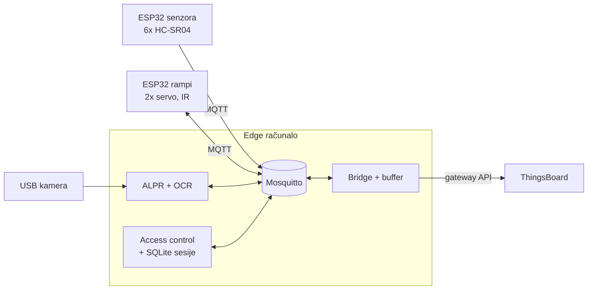

# IoT Garaža

- **Projekt:** IoT Garaža, ak. god. 2026/27
- **Puni naziv projekta:** Pametna parkirna garaža s automatskim prepoznavanjem registarskih oznaka (ALPR),
  lokalnim (edge) upravljanjem ulaskom i izlaskom te digitalnim blizancem u platformi ThingsBoard
- **Trajanje:** 19.10.2026. – 29.1.2027. (rok za predaju)
- **Datum prezentacije:** _upisati_

Pametna garaža na maketi: kamera čita registraciju, **edge računalo lokalno odlučuje** o ulasku, rampa se
otvara, senzori prate zauzetost mjesta, parkirna sesija se naplaćuje pri izlasku, a sve se prikazuje u
ThingsBoardu i mobilnoj aplikaciji.

## Sadržaj repozitorija

Struktura slijedi [upute nastavnika](OSTALO/upute-nastavnika-gitlab.md); svaka mapa ima `README.md` s opisom.

| mapa | sadržaj |
|---|---|
| [PROJEKT](PROJEKT) | [prijedlog i plan projekta](PROJEKT/plan-projekta) (DOCX + PDF), [završna dokumentacija](PROJEKT/dokumentacija), [arhitektura i MQTT ugovor](PROJEKT/sustav), [plan rada, rizici, odluke](PROJEKT/upravljanje), [nacrt makete](PROJEKT/maketa), [testiranje](PROJEKT/testiranje) |
| [SOFTWARE](SOFTWARE) | sav kod – firmware, edge servis, baza, ThingsBoard, simulacija, 3D dijelovi; [instalacija](SOFTWARE/INSTALL.md) |
| [PREZENTACIJA](PREZENTACIJA) | [demo scenarij](PREZENTACIJA/demo-scenarij.md), završna prezentacija |
| [OSTALO](OSTALO) | [literatura i poveznice](OSTALO/literatura.md), upute nastavnika |



## Tim

Svaki dio sustava ima svoju mapu s **README-om: tko je zadužen, što je već napravljeno, kako se koristi i što još treba napraviti**.

| | uloga | tko | mapa |
|---|---|---|---|
| 1 | voditelj, arhitektura, integracija | Patrik | [PROJEKT/upravljanje](PROJEKT/upravljanje) |
| 2 | maketa, napajanje, ožičenje | Patrik, Lovro Gale | [SOFTWARE/maketa](SOFTWARE/maketa) |
| 3 | senzori mjesta, firmware | Toma Burgund (+ Lovro Gale) | [SOFTWARE/senzori](SOFTWARE/senzori) |
| 4 | rampe, aktuatori, lokalna kontrola pristupa | Luka Oslić | [SOFTWARE/rampe](SOFTWARE/rampe) |
| 5 | ALPR – detekcija pločice | Sven Matić | [SOFTWARE/alpr](SOFTWARE/alpr) |
| 6 | OCR, edge servis | Lukas Davorija (+ Luka Oslić za access control) | [SOFTWARE/edge](SOFTWARE/edge) |
| 7 | ThingsBoard | Anja, Leo Hreljanović (analitika) | [SOFTWARE/thingsboard](SOFTWARE/thingsboard) |
| 8 | baza, testovi, GitHub | Lovro Gale | [SOFTWARE/baza](SOFTWARE/baza) |

<!-- gitlab:izostavi -->
**Voditelj:** [vodič za voditelja](PROJEKT/upravljanje/vodic-za-voditelja.md) – stanje projekta, pojmovi, postavljanje
i integracija hardvera korak po korak.

<!-- /gitlab -->
Leo Hreljanović uz to izrađuje **[mobilnu aplikaciju za analitiku garaže](SOFTWARE/mobilna-aplikacija)** (zauzetost, ulasci po satu, prosječno trajanje, povijest sesija), koja podatke čita iz ThingsBoarda preko REST API-ja.

<!-- gitlab:od-tjedna=12 -->
**Stanje:** rezultati svih testova (automatskih, u simulaciji i na maketi) vode se u
[testnom zapisniku](PROJEKT/testiranje/testni-zapisnik.md).
<!-- /gitlab -->

## Arhitektura ukratko



Detalji: [arhitektura](PROJEKT/sustav/arhitektura.md) · [MQTT teme i poruke](PROJEKT/sustav/komunikacijski-ugovor.md) ·
[odluke](PROJEKT/upravljanje/odluke.md) · [demo scenarij](PREZENTACIJA/demo-scenarij.md)

<!-- gitlab:do-tjedna=7
## Brzi start

```bash
cd SOFTWARE
python -m venv .venv && source .venv/bin/activate        # Windows: .venv\Scripts\activate
pip install -r requirements-dev.txt
pytest
```

Upute za pojedine dijelove sustava su u `README.md` datotekama mapa u [SOFTWARE](SOFTWARE).
-->
<!-- gitlab:od-tjedna=8 -->
## Brzi start – cijeli sustav bez hardvera (5 minuta)

Treba: Python ≥ 3.8, [Tesseract OCR](https://tesseract-ocr.github.io/tessdoc/Installation.html) i
[Mosquitto](https://mosquitto.org/download/) (Linux: `sudo apt install tesseract-ocr mosquitto`).

```bash
git clone <repo> && cd IoTGarage/SOFTWARE              # sve naredbe se pokreću iz mape SOFTWARE
python -m venv .venv && source .venv/bin/activate        # Windows: .venv\Scripts\activate
pip install -r requirements-dev.txt

python integracija/simulacija.py --broker     # odigra demo: ulaz, parkiranje, nečitljiva pločica, izlaz s cijenom
pytest                                        # svi testovi
```

S ThingsBoardom (Docker):

```bash
cd thingsboard && docker compose up -d && python provision/provision.py && cd ..
python integracija/simulacija.py --broker --tb --interactive
# http://localhost:8080  (tenant@thingsboard.org / tenant) -> Dashboards -> "Garaža - nadzor"
```

Korisni alati:

```bash
python -m garage_contract.monitor                                  # sve MQTT poruke, crveno = krši ugovor
python -m edge_service read slika.jpg                              # pročitaj registraciju sa slike
python alpr/tools/generate_plates.py --out tablice                 # pločice za ispis
parking-sessions --db data/garage.db list --active                 # tko je u garaži
```

<!-- /gitlab -->
<!-- gitlab:od-tjedna=9 -->
Firmware, edge računalo i sve varijable konfiguracije: [SOFTWARE/INSTALL.md](SOFTWARE/INSTALL.md).
<!-- /gitlab -->

## Struktura i pravila

- Python paketi se instaliraju iz svojih mapa (`SOFTWARE/requirements-dev.txt`), firmware je PlatformIO.
- Sva vremena: **UTC ISO 8601**. Sve registracije: **izmišljene**.
- Promjena MQTT poruka samo kroz voditelja (sheme u `SOFTWARE/ugovor`) – testovi provjeravaju sve primjere.
<!-- gitlab:izostavi -->
- Svatko radi u svojoj grani i otvara Pull Request; **CI** (`.github/workflows/ci.yml`) mora biti zelen:
  Python testovi (3.8 i 3.12) + e2e simulacija, prevođenje i unit testovi oba firmwarea, renderiranje 3D dijelova.
- Službeni GitLab repozitorij puni se tjedan po tjedan: [.gitlab-tjedni](.gitlab-tjedni/README.md).
<!-- /gitlab -->
<!-- gitlab:do-tjedna=15
- Prije svakog commita: `pytest` u mapi `SOFTWARE` mora proći.
-->
- Ne komitati: `secrets.h`, `edge.yaml`, baze `*.db`, stvarne fotografije.
