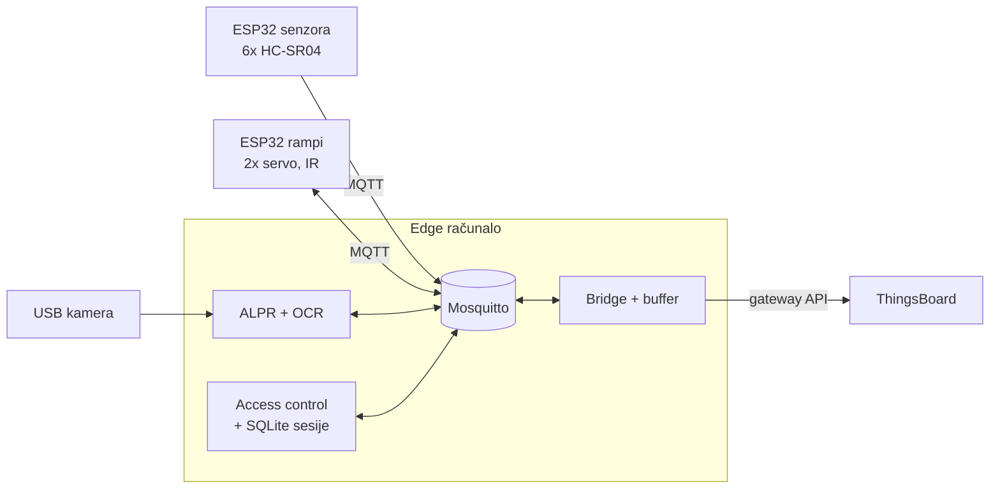

# IoT Garaža

Pametna garaža na maketi: kamera čita registraciju, **edge računalo lokalno odlučuje** o ulasku, rampa se
otvara, senzori prate zauzetost mjesta, parkirna sesija se naplaćuje pri izlasku, a sve se prikazuje u
ThingsBoardu.


## Tim i folderi

Svaka osoba ima svoj folder s **README-om: što je već napravljeno, kako se koristi i što još treba napraviti**.

| | uloga | folder | pripremljeno |
|---|---|---|---|
| 1 | voditelj, arhitektura, integracija | [osoba-1-voditelj](osoba-1-voditelj) | arhitektura, **komunikacijski ugovor kao kod** (JSON sheme + Python paket), zahtjevi, rizici, odluke, plan rada, demo scenarij, **simulacija cijelog sustava** + e2e testovi |
| 2 | maketa, napajanje, ožičenje | [osoba-2-maketa](osoba-2-maketa) | tlocrt 1:1, kalkulator položaja kamere, 7 parametarskih 3D dijelova (STL), dijagrami ožičenja, popis komponenti, proračun napajanja |
| 3 | senzori mjesta, firmware | [osoba-3-senzori](osoba-3-senzori) | ESP32 firmware (6× HC-SR04, filtar, MQTT, reconnect, LWT), unit testovi, simulator, alati za kalibraciju i test 20× |
| 4 | rampe, aktuatori | [osoba-4-rampe](osoba-4-rampe) | ESP32 firmware (2 rampe, stroj stanja, sigurnost, tipke), unit testovi, simulator, sigurnosni testovi |
| 5 | ALPR – detekcija pločice | [osoba-5-alpr](osoba-5-alpr) | OpenCV detektor, ispravak perspektive, **pločice za ispis**, sintetski skup, alati za snimanje/označavanje/mjerenje |
| 6 | OCR, edge servis | [osoba-6-ocr-edge](osoba-6-ocr-edge) | dvostruki OCR s glasanjem, HR format, ALPR servis, **access control** (odluke, sesije, rampe, alarmi), Docker za Raspberry Pi/Jetson |
| 7 | ThingsBoard | [osoba-7-thingsboard](osoba-7-thingsboard) | docker-compose, provisioning jednom naredbom, bridge s međuspremnikom, **2 dashboarda**, 7 pravila alarma, RPC gumbi |
| 8 | baza, testovi, dokumentacija | [osoba-8-baza-testovi](osoba-8-baza-testovi) | SQLite sesije + naplata + CLI, testni plan (~60 slučajeva), testni zapisnik, kostur dokumentacije, korisničke upute |

**Što je provjereno:** 143 automatska testa prolaze; cijeli sustav radi u simulaciji (0 poruka koje krše
ugovor); oba firmwarea se prevode za ESP32; ThingsBoard dashboardi, alarmi, RPC, međuspremnik pri ispadu i
restart provjereni na ThingsBoard CE 4.2.1. **Što još nije:** ništa nije isprobano na stvarnom hardveru, a
ALPR je mjeren samo na sintetskim slikama – to je posao za tim (vidi [plan rada](osoba-1-voditelj/plan-rada.md)).

## Arhitektura ukratko



Detalji: [arhitektura](osoba-1-voditelj/arhitektura.md) · [MQTT teme i poruke](osoba-1-voditelj/komunikacijski-ugovor.md) ·
[odluke](osoba-1-voditelj/odluke.md) · [demo scenarij](osoba-1-voditelj/demo-scenarij.md)

## Brzi start – cijeli sustav bez hardvera (5 minuta)

Treba: Python ≥ 3.8, [Tesseract OCR](https://tesseract-ocr.github.io/tessdoc/Installation.html) i
[Mosquitto](https://mosquitto.org/download/) (Linux: `sudo apt install tesseract-ocr mosquitto`).

```bash
git clone <repo> && cd IoTGarage
python -m venv .venv && source .venv/bin/activate        # Windows: .venv\Scripts\activate
pip install -r requirements-dev.txt

python osoba-1-voditelj/integracija/simulacija.py --broker     # odigra demo: ulaz, parkiranje, nečitljiva pločica, izlaz s cijenom
pytest                                                          # svi testovi
```

S ThingsBoardom (Docker):

```bash
cd osoba-7-thingsboard && docker compose up -d && python provision/provision.py && cd ..
python osoba-1-voditelj/integracija/simulacija.py --broker --tb --interactive
# http://localhost:8080  (tenant@thingsboard.org / tenant) -> Dashboards -> "Garaža - nadzor"
```

Korisni alati:

```bash
python -m garage_contract.monitor                                  # sve MQTT poruke, crveno = krši ugovor
python -m edge_service read slika.jpg                              # pročitaj registraciju sa slike
python osoba-5-alpr/tools/generate_plates.py --out tablice         # pločice za ispis
parking-sessions --db data/garage.db list --active                 # tko je u garaži
```

## Struktura i pravila

- Python paketi se instaliraju iz svojih foldera (`requirements-dev.txt`), firmware je PlatformIO.
- Sva vremena: **UTC ISO 8601**. Sve registracije: **izmišljene**.
- Promjena MQTT poruka samo kroz osobu 1 (sheme u `osoba-1-voditelj/contract`) – CI provjerava sve primjere.
- Svatko radi u svojoj grani i otvara Pull Request; **CI** (`.github/workflows/ci.yml`) mora biti zelen:
  Python testovi (3.8 i 3.12) + e2e simulacija, prevođenje i unit testovi oba firmwarea, renderiranje 3D dijelova.
- Ne komitati: `secrets.h`, `edge.yaml`, baze `*.db`, stvarne fotografije.
