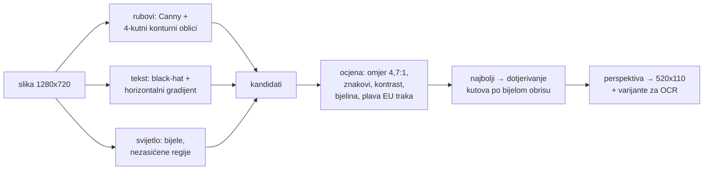

# Osoba 5 – ALPR: detekcija registarske pločice

**Zadužen:** Sven Matić. Zamjena: Lukas Davorija.

Tvoj modul pronalazi **gdje** je pločica na slici, ispravlja perspektivu i vraća izrezanu pločicu.
**Ne** čita znakove i **ne** odlučuje je li registracija valjana (to radi osoba 6).

## Što je već napravljeno

| | sadržaj |
|---|---|
| [plate_detector/detector.py](plate_detector/detector.py) | detektor (OpenCV): 3 nezavisna izvora kandidata, ocjena kandidata, precizno dotjerivanje kutova, ispravak perspektive |
| [plate_detector/variants.py](plate_detector/variants.py) | varijante za OCR: izvorna, grayscale, pojačani kontrast (CLAHE), threshold (Otsu), adaptivni threshold |
| [plate_detector/camera.py](plate_detector/camera.py) | USB kamera koja uvijek vraća **najnoviju** sliku (pozadinska nit, MJPG, automatsko ponovno otvaranje) |
| [plate_detector/synth.py](plate_detector/synth.py) | generator izmišljenih HR pločica i sintetskih scena s poznatim kutovima (za testove i simulaciju) |
| [tools/generate_plates.py](tools/generate_plates.py) | **pločice za ispis** u točnoj veličini (A4 PDF) → [tablice/plates_A4.pdf](tablice/plates_A4.pdf) |
| [tools/capture_dataset.py](tools/capture_dataset.py) | snimanje vlastitog skupa fotografija kamerom (s automatskim označavanjem kutova) |
| [tools/label_tool.py](tools/label_tool.py) | provjera/ručno klikanje 4 kuta pločice |
| [tools/evaluate_detection.py](tools/evaluate_detection.py) | mjerenje uspješnosti (IoU ≥ 0,5), izvještaj + slike promašaja |
| [tools/detect_image.py](tools/detect_image.py) | probaj detektor na slikama, spremi okvir, izrez i varijante |
| [tools/make_synthetic_dataset.py](tools/make_synthetic_dataset.py) | sintetski skup s oznakama (dok nema stvarnih fotografija) |
| [rezultati/](rezultati) | izvještaji mjerenja |
| [dataset/README.md](dataset/README.md) | kako snimiti i označiti stvarni skup (privatnost!) |
| [ogranicenja.md](../../PROJEKT/testiranje/ogranicenja-alpr.md) | dokumentirane situacije u kojima detekcija ne radi |
| [tests/](tests) | 9 unit testova |

### Rezultati na sintetskim slikama (stvarne fotografije makete tek treba snimiti)

| skup | uspješnost | lažno pozitivni | vrijeme (medijan) |
|---|---|---|---|
| kontrolirani uvjeti (fiksna kamera, ±15° kut, dobro svjetlo) | **100 %** (150/150) | 0/15 | ~35 ms |
| teški uvjeti (±45° kut, mrak/presvijetlo, zamućenje, šum, JPEG) | **95,3 %** (143/150) | 0/15 | ~37 ms |

Kriterij projekta je **≥ 90 % na vlastitim fotografijama makete** – sintetski rezultat je samo pokazatelj.

## Kako radi



```python
from plate_detector import PlateDetector
r = PlateDetector().detect(frame_bgr)            # opcionalno roi=(x0, y0, x1, y1) u udjelima slike
r.found, r.confidence, r.corners, r.bbox, r.crop, r.variants, r.processing_ms
```

## Brzi start

```bash
pip install -e ".[gui]"          # laptop s prozorima (capture/label); edge uređaj: ".[headless]"
python tools/generate_plates.py --out tablice                 # pločice za ispis (izmišljene!)
python tools/capture_dataset.py --out dataset/real/v1 --plate ZG1234AB --lighting svijetlo --angle 0 --distance blizu
python tools/label_tool.py dataset/real/v1
python tools/evaluate_detection.py dataset/real/v1            # izvještaj u rezultati/
python tools/detect_image.py moja_slika.jpg --out rezultati/probe
pytest tests
```

## Tvoji zadaci

- [ ] isprintati pločice (100 %, mat papir), zalijepiti na autiće (držač `SOFTWARE/maketa/3d/drzac_tablice.scad`)
- [ ] postaviti kameru na fiksan položaj s osobom 2 (`kamera_kalkulator.py`), provjeriti fokus
- [ ] snimiti stvarni skup (≥ 100 slika): različite registracije, kutovi, svjetlije/tamnije, bliže/dalje – vidi [dataset/README.md](dataset/README.md)
- [ ] označiti (`label_tool.py`) i izmjeriti (`evaluate_detection.py`) → cilj ≥ 90 %
- [ ] dopuniti [ogranicenja.md](../../PROJEKT/testiranje/ogranicenja-alpr.md) stvarnim primjerima (slike iz `rezultati/debug/`)
- [ ] ako stvarni rezultat < 90 %: podesiti `DetectorConfig` / težine ocjene u `detector.py` i ponoviti mjerenje

| isporučivo | status |
|---|---|
| modul za detekciju pločice | ✅ `plate_detector` (koristi ga edge servis) |
| testni skup fotografija | ✅ sintetski, ⬜ stvarni |
| mjerenje uspješnosti detekcije | ✅ alat + sintetski izvještaji, ⬜ stvarni |
| dokumentirane situacije u kojima ne radi | ✅ početna verzija, ⬜ dopuniti stvarnim primjerima |
