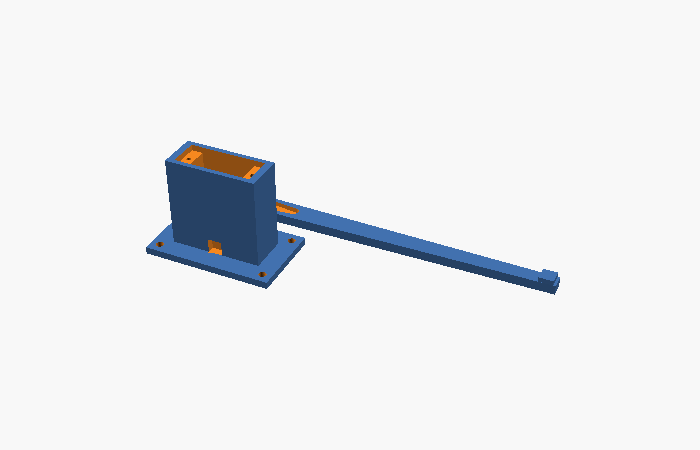
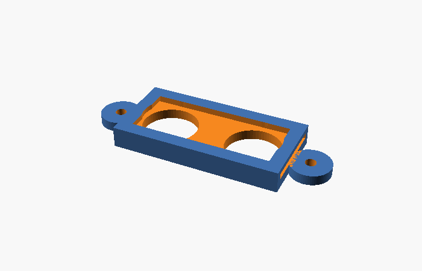
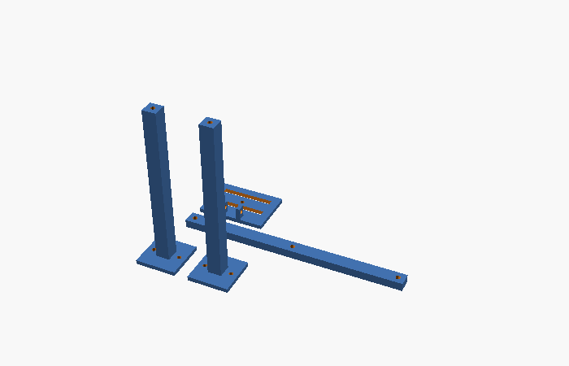
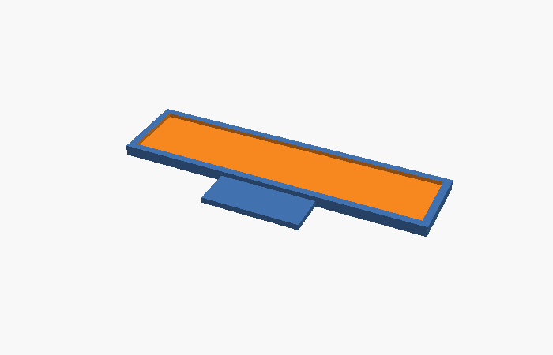

# 3D dijelovi (OpenSCAD)

Svi dijelovi su parametarski – otvori `.scad` u [OpenSCAD](https://openscad.org), promijeni varijable na vrhu
(npr. `lane_width`, `arm_height`) i izvezi STL. Gotovi STL-ovi za zadane mjere su u [stl/](stl).
CI provjerava da se svaki dio može izrenderirati.

| dio | datoteka | kom | opis |
|---|---|---|---|
|  | `rampa_sg90.scad` | 2 | stup za SG90 + ruka rampe s utorom za servo nastavak; `part = "post" / "arm"` |
|  | `nosac_hcsr04.scad` | 6 | nosač HC-SR04 ispod mosta, senzor gleda prema dolje |
| | `nosac_ir.scad` | 2 | FC-51 okomito na crti rampe, LED-ice na visini branika |
|  | `most_kamere.scad` | 1–2 | most iznad trake (2 noge + prečka) + nagibna pločica za kameru (0–40°) |
|  | `drzac_tablice.scad` | 6 | okvir za tiskanu pločicu 60 × 12,7 mm, lijepi se na autić |
| | `granicnik.scad` | 2 | graničnik kotača = ponovljiv položaj vozila ispred kamere |
| | `kabelski_kanal.scad` | po potrebi | kanal 14 × 9 mm s poklopcem |

Ispis: PLA, sloj 0,2 mm, ispuna 20 %, bez potpornja (dijelovi su položeni ravno).
Servo pričvrstiti vijcima iz kompleta serva; ruku rampe zalijepiti na jednokraki nastavak serva.
Ruku obojiti/oblijepiti crveno-bijelo.
