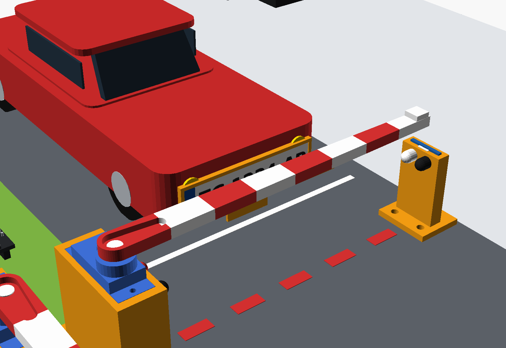
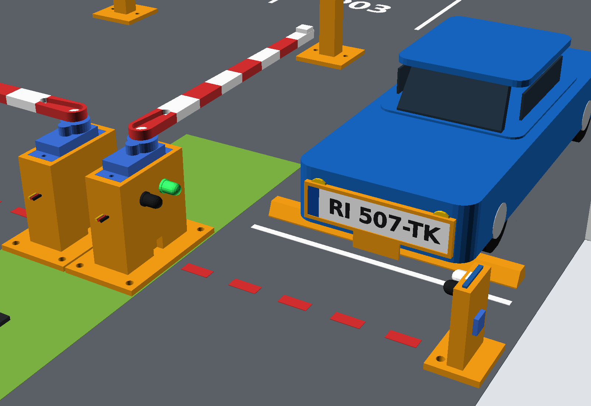
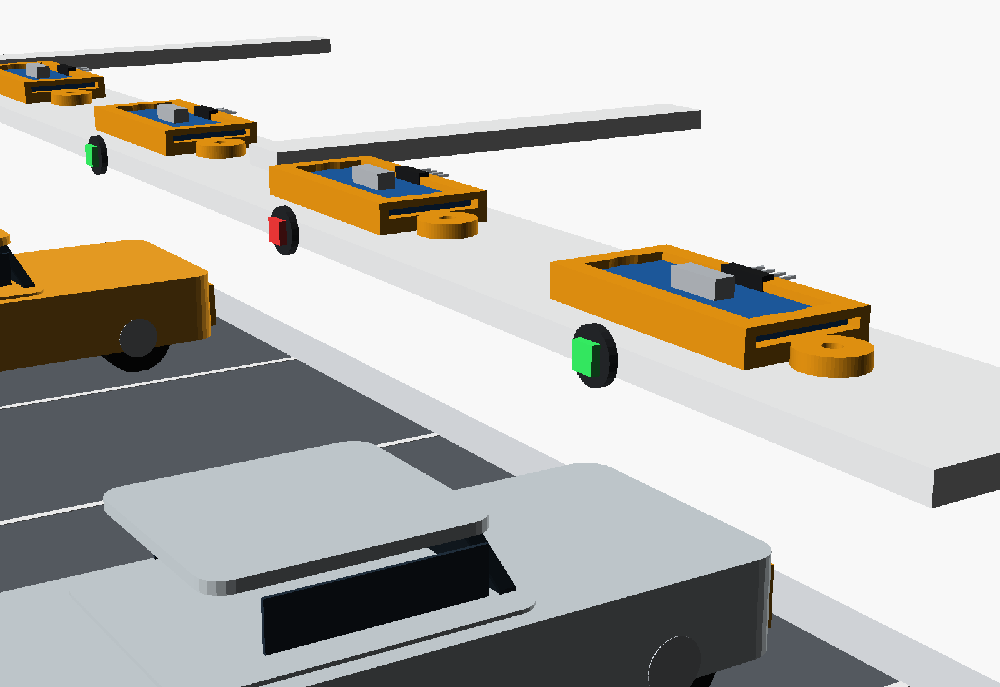
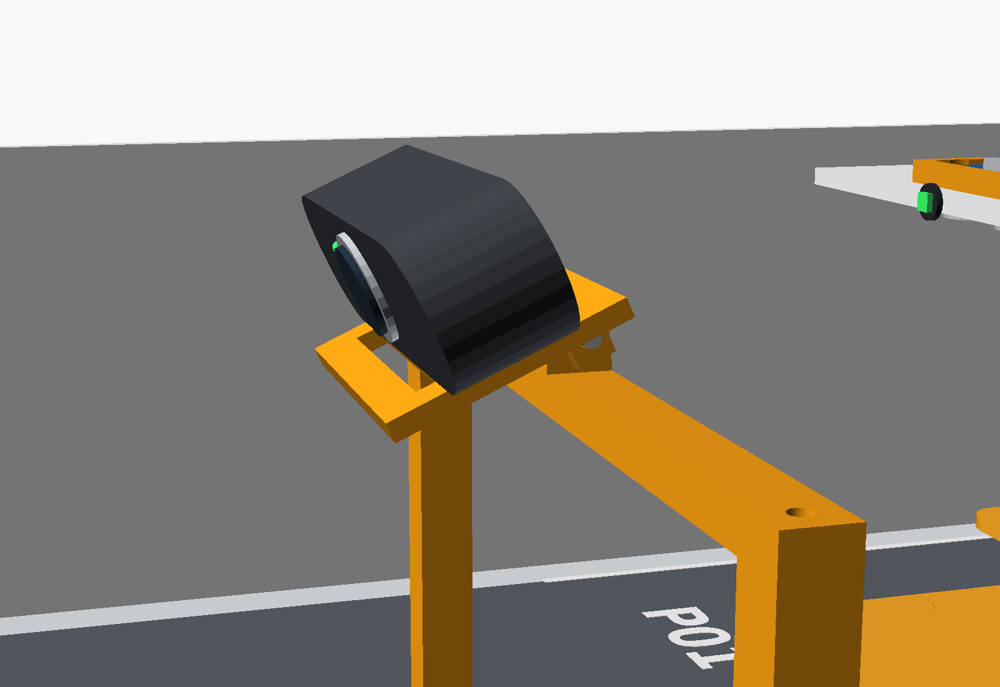
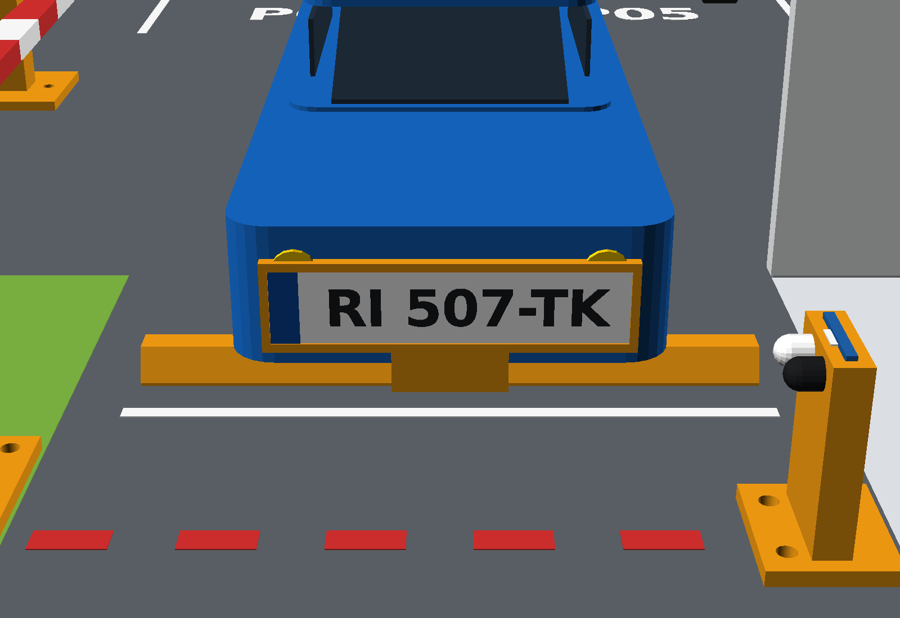
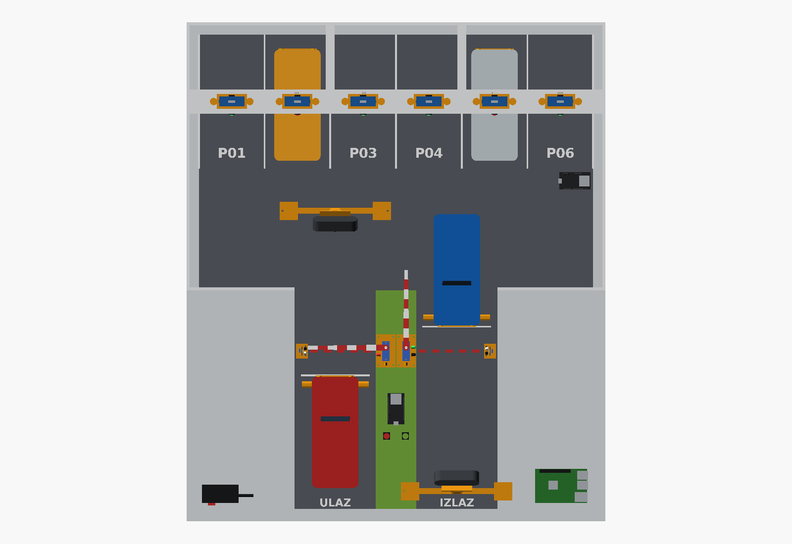
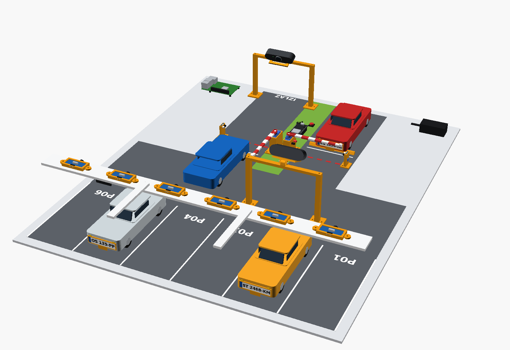
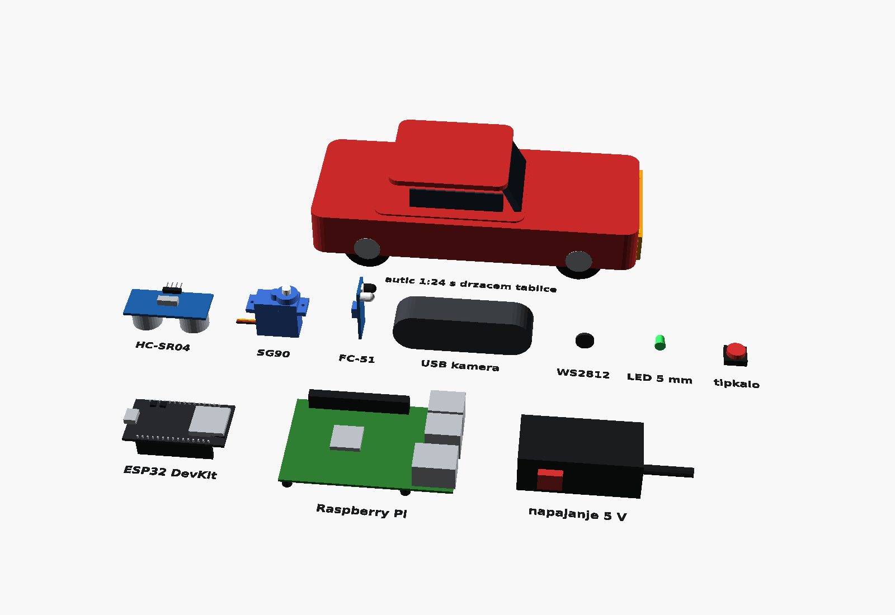

# 3D sklop cijele makete

Cijela maketa u 3D-u: baza s oznakama, zidovi, most sa 6 HC-SR04 senzora i LED-icama mjesta, rampe sa SG90
servima, IR senzori, mostovi kamera s USB kamerama, ESP32 čvorovi, tipkala, Raspberry Pi, napajanje i autići
1:24 s pločicama. Isprintani dijelovi (narančasto) su isti `.scad` dijelovi iz [3d/](..) – sklop ih samo
postavlja na mjesto, pa se svaka promjena dijela odmah vidi i u sklopu.

Scena: auto čeka na ulazu (rampa zatvorena, crvena LED), auto izlazi kroz otvorenu izlaznu rampu (zelena LED),
mjesta P02 i P05 su zauzeta (crvena LED na mostu).


| | |
|---|---|
|  ulaz: rampa zatvorena, IR senzor na crti rampe |  izlaz: rampa otvorena, auto na graničniku |
|  most sa senzorima mjesta (zauzeto = crvena LED) |  kamera na nagibnoj pločici, M3 vijak kao os |
|  **pogled iz ulazne kamere** |  **pogled iz izlazne kamere** |
|  tlocrt |  bez zidova, sa sjeverozapada |

## Kako otvoriti

- **U pregledniku, bez instalacije:** [sklop_makete.stl](sklop_makete.stl) – GitHub i GitLab STL prikazuju kao
  3D model koji se može okretati (jednobojno).
- **U boji:** [sklop_makete.glb](sklop_makete.glb) – Windows 3D Viewer, Blender ili
  <https://gltf-viewer.donmccurdy.com> (povuci datoteku u prozor).
- **Za mijenjanje:** `sklop_makete.scad` u [OpenSCAD-u](https://openscad.org) (F5 = brzi pregled u boji).

## Parametri (vrh `sklop_makete.scad`)

| parametar | zadano | značenje |
|---|---|---|
| `car_scale` | 24 | mjerilo autića, isto kao `alati/tlocrt.py --scale` |
| `spots` | 6 | broj mjesta (`tlocrt.py --spots`) |
| `occupied` | `[2, 5]` | zauzeta mjesta (autić + crvena LED) |
| `exit_open` | `true` | izlazna rampa otvorena |
| `show_walls`, `show_cars` | `true` | prikaz zidova i autića |

Raspored se računa istim formulama kao u `alati/tlocrt.py`, pa se 3D model, tlocrt 1:1 i kalkulator kamere uvijek
slažu (za 1:24 i 6 mjesta baza je 688 × 821 mm). OpenSCAD u konzoli ispisuje dimenzije baze i položaj kamere.

## Izvoz slika i 3D datoteka

```bash
python izvoz.py            # sve: slike/*.png + sklop_makete.stl + sklop_makete.glb (~1,5 min)
python izvoz.py --slike    # samo slike (~20 s)
python izvoz.py --3d       # samo STL i GLB
```

Potrebni su samo OpenSCAD (2021.01 ili noviji) i Python, bez dodatnih paketa. STL i GLB nastaju tako da se svaka
grupa boja (tablica `BOJE` u `komponente.scad`) izrenderira zasebno (`-D grupa=...`) i zatim se sve spoji.

| datoteka | sadržaj |
|---|---|
| `sklop_makete.scad` | cijela maketa: raspored, postavljanje dijelova, scena |
| `komponente.scad` | pojednostavljeni modeli kupljenih komponenti (mjere iz tablica proizvođača); otvoren sam za sebe prikazuje katalog ispod |
| `izvoz.py` | slike, STL i GLB |



## Što je sklop provjerio

- **Kamera vidi pločicu preko ruke rampe.** Sklop iz geometrije izračuna nagib kamere tako da gleda u središte
  pločice auta koji stoji na zaustavnoj crti (objektiv 129 mm iznad poda i 200 mm iza crte rampe, nagib 24,4°) i
  iz te točke izrenderira pogled iz kamere: ruka rampe prolazi iznad pločice. Isto pokazuje
  `alati/kamera_kalkulator.py --cam-behind 200 --cam-height 129 --plate-height 20` (zraka na crti rampe 38 mm,
  ruka 50–54 mm). OpenSCAD ima uži kut gledanja od prave kamere, pa je taj pogled "zumiran".
- **Nagibna pločica kamere nije se imala za što uhvatiti** – prečka mosta imala je samo okomitu rupu. U
  `most_kamere.scad` sada je na sredini prečke **blok šarnira**: ulazi između dviju uški pločice, a M3 vijak je
  os nagiba. Noge su skraćene sa 118 na 110 mm, pa je objektiv i dalje na ~130 mm.
- **Nosač HC-SR04 stoji na mostu**, a senzor gleda prema dolje kroz dvije rupe Ø 17 mm u mostu (opis je prije
  govorio "ispod mosta").
- Graničnik kotača je postavljen tako da pločica stoji točno na zaustavnoj crti, a autić (~56 mm) prolazi ispod
  mosta senzora (113 mm) i mosta kamere (prečka na 110 mm).
