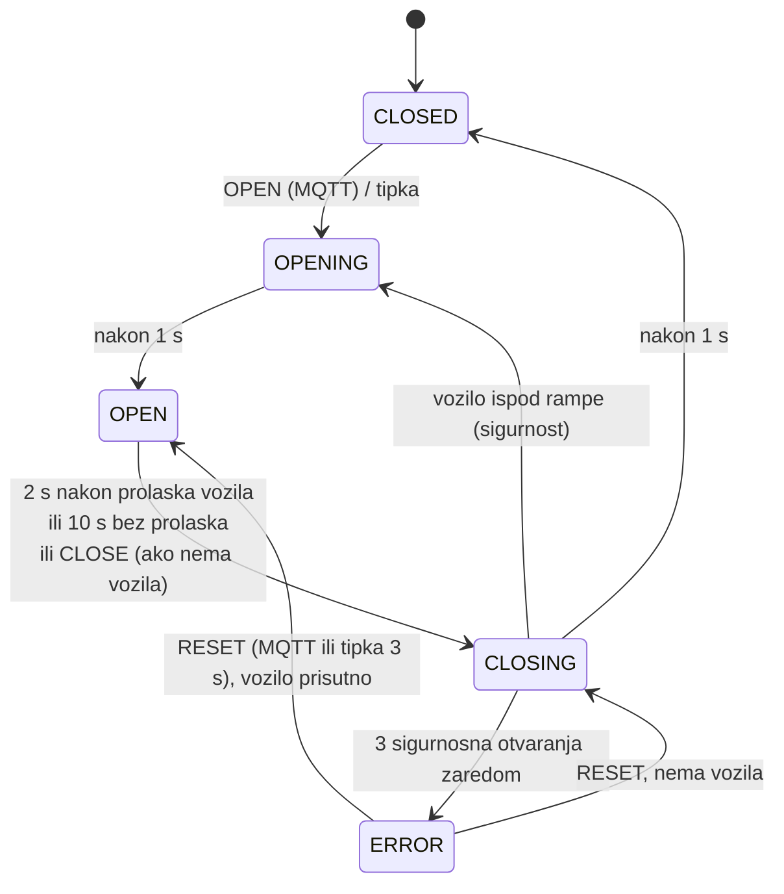

# Rampe, aktuatori i lokalna kontrola pristupa

Zadužen: Luka Oslić, za rampe i aktuatore te, s Lukasom, za pravila lokalne kontrole pristupa (`decisions.py` i
`access_control.py` u [SOFTWARE/edge/edge_service](../edge/edge_service)). Zamjena: Lukas Davorija.

Rampa izvršava naredbe i čuva sigurnost (ne zatvara se na vozilo). Smije li vozilo ući, odlučuje access control na
edge računalu.

## Što je već napravljeno

| | sadržaj |
|---|---|
| [firmware/](firmware) | PlatformIO projekt za ESP32: 2 servo rampe, IR senzori, LED, tipke, zujalica, MQTT naredbe i potvrde, Last Will, heartbeat |
| [firmware/lib/GateLogic](firmware/lib/GateLogic) | stroj stanja rampe (`CLOSED/OPENING/OPEN/CLOSING/ERROR`), čisti C++ |
| [firmware/test/](firmware/test/test_gate/test_main.cpp) | unit testovi stroja stanja na PC-u |
| [simulator/](simulator) | Python blizanac istog stroja stanja i MQTT simulator obje rampe, s testovima |
| [sigurnosni-testovi-rampi.md](../../PROJEKT/testiranje/sigurnosni-testovi-rampi.md) | sigurnosni testovi s koracima i očekivanim rezultatom |

Firmware je preveden i testovi prolaze, ali na hardveru još nije isproban.

## Stroj stanja



- `CLOSE` dok je vozilo ispod rampe se odbija (`success:false, reason:"VEHICLE_PRESENT"`).
- Svaka naredba ima `requestId`. Isti `requestId` drugi put dobiva potvrdu `DUPLICATE` i ne izvršava se ponovno.
- U `ERROR` rampa ostaje gore, gdje ne može ozlijediti vozilo, dok je netko ne resetira.
- Sve radi lokalno: bez Wi-Fi-ja i MQTT-a tipka i dalje otvara, a rampa se i dalje sama zatvara.

Naredbe, potvrde i rok od 3 s za potvrdu opisani su u
[komunikacijskom ugovoru](../../PROJEKT/sustav/komunikacijski-ugovor.md#naredba-rampi-i-odgovor).

## Brzi start

1. Kopiraj `firmware/include/secrets.example.h` u `secrets.h` (Wi-Fi, IP edge računala).
2. Spoji jedan SG90 (napajanje iz 5 V adaptera, ne iz ESP32), IR senzor na 3,3 V, tipku i LED prema
   [shemi](../../PROJEKT/maketa/shema-spajanja.md).
3. `pio run -t upload -d firmware`, zatim `pio device monitor -d firmware`.
4. Serijske naredbe: `open e`, `close e`, `reset e`, `status` (`x` = izlaz).
5. Preko MQTT-a: `python -m edge_service manual open --gate entrance` ili
   `python -m garage_contract.monitor --pub garage/gate/entrance/command '{"requestId":"t1","command":"OPEN"}'`.
6. Kalibriraj kutove u `config.h` (`closedAngle`, `openAngle`): zatvorena ruka stoji ravno preko trake, a otvorena je
   okrenuta uz otok (isprintana ruka se okreće vodoravno, vidi [3D sklop](../maketa/3d/sklop)).

Unit testovi: `pio test -e native -d firmware` i `pytest simulator`.

## Simulator (za ostale članove)

```bash
python simulator/gate_simulator.py                 # "e" = vozilo na ulazu, "be" = tipka ulaza
python simulator/gate_simulator.py --no-ack exit   # izlazna rampa ne odgovara -> test alarma
```

Python simulator i C++ firmware imaju isti stroj stanja. Ako mijenjaš jedan, promijeni i drugi, zajedno s testovima.

## Zadaci

- ✅ firmware i definirana MQTT sučelja (ugovor i simulator)
- ✅ ručno upravljanje kad ALPR ne radi: tipka, serijske naredbe, gumb na dashboardu, `edge_service manual`
- ✅ plan sigurnosnih testova · ⬜ provedba
- ⬜ jedan servo pokrenut s ESP32-a (KT2)
- ⬜ montaža obje rampe s Patrikom, kalibracija kutova, LED i tipke
- ⬜ IR senzori na crti rampe: moraju vidjeti autić, a ne ruku rampe
- ⬜ [sigurnosni testovi](../../PROJEKT/testiranje/sigurnosni-testovi-rampi.md) na hardveru, rezultate predati Lovri
- ⬜ test bez mreže: isključi router, tipka i automatsko zatvaranje moraju raditi; nakon uključivanja stanje se ponovno objavi
