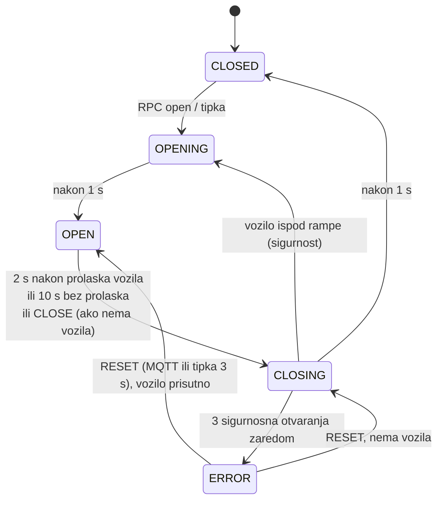

# Rampe, aktuatori i pravila odluke

Zadužen: Luka Oslić, za rampe i aktuatore te, s Anjom, za pravila odluke u rule chainu ThingsBoarda
([`decide.tbel`](../thingsboard/rulechain/scripts/decide.tbel)). Zamjena: Lukas Davorija.

Rampa izvršava naredbe i čuva sigurnost (ne zatvara se na vozilo). Smije li vozilo ući, odlučuje rule chain
ThingsBoarda ([varijanta B](../../PROJEKT/sustav/varijanta-b.md)).

## Što je već napravljeno

| | sadržaj |
|---|---|
| [firmware/](firmware) | PlatformIO projekt za ESP32: 2 servo rampe, IR senzori, LED, tipke, zujalica; ThingsBoard gateway `esp32-gates` (RPC `open`/`close`/`reset`/`deny` s odgovorom, `vehicleArrived`), heartbeat |
| [firmware/lib/GateLogic](firmware/lib/GateLogic) | stroj stanja rampe (`CLOSED/OPENING/OPEN/CLOSING/ERROR`), čisti C++ |
| [firmware/test/](firmware/test/test_gate/test_main.cpp) | unit testovi stroja stanja na PC-u |
| [simulator/](simulator) | Python blizanac istog stroja stanja, simulator obje rampe za ThingsBoard (`gate_simulator_tb.py`), s testovima |
| [sigurnosni-testovi-rampi.md](../../PROJEKT/testiranje/sigurnosni-testovi-rampi.md) | sigurnosni testovi s koracima i očekivanim rezultatom |

Firmware je preveden i testovi prolaze, ali na hardveru još nije isproban.

## Stroj stanja



- `CLOSE` dok je vozilo ispod rampe se odbija (`success:false, reason:"VEHICLE_PRESENT"`).
- Svaki RPC dobiva odgovor `{"success", "state", "reason"}`; rule chain čeka najviše 5 s, inače alarm
  „Rampa ne potvrđuje naredbe“. `deny` samo kratko zapišti.
- Kad vozilo dođe do zatvorene rampe, firmware pošalje `vehicleArrived: true`; tada rule chain traži ALPR.
- U `ERROR` rampa ostaje gore, gdje ne može ozlijediti vozilo, dok je netko ne resetira.
- Sve radi lokalno: bez Wi-Fi-ja i ThingsBoarda tipka i dalje otvara, a rampa se i dalje sama zatvara.

Teme, RPC metode i telemetrija su u [komunikacijskom ugovoru](../../PROJEKT/sustav/komunikacijski-ugovor.md).

## Brzi start

1. Kopiraj `firmware/include/secrets.example.h` u `secrets.h` (Wi-Fi, IP laptopa s ThingsBoardom, *access token*
   uređaja `esp32-gates`).
2. Spoji jedan SG90 (napajanje iz 5 V adaptera, ne iz ESP32), IR senzor na 3,3 V, tipku i LED prema
   [shemi](../../PROJEKT/maketa/shema-spajanja.md).
3. `pio run -t upload -d firmware`, zatim `pio device monitor -d firmware`.
4. Serijske naredbe: `open e`, `close e`, `reset e`, `status` (`x` = izlaz).
5. Iz ThingsBoarda: gumb „Otvori ulaz“ na nadzornom dashboardu ili RPC `open` na uređaj `EntranceGate`.
6. Kalibriraj kutove u `config.h` (`closedAngle`, `openAngle`): zatvorena ruka stoji ravno preko trake, a otvorena je
   okrenuta uz otok (isprintana ruka se okreće vodoravno, vidi [3D sklop](../maketa/3d/sklop)).

Unit testovi: `pio test -e native -d firmware` i `pytest simulator`.

## Simulator (za ostale članove)

Treba ThingsBoard s `provision.py` ([INSTALL.md §3](../INSTALL.md#3-thingsboard-laptop-ili-server-s--4-gb-ram)).

```bash
python simulator/gate_simulator_tb.py                 # "e" = vozilo na ulazu, "be" = tipka ulaza
python simulator/gate_simulator_tb.py --no-ack exit   # izlazna rampa ne odgovara -> test alarma
```

Python simulator i C++ firmware imaju isti stroj stanja. Ako mijenjaš jedan, promijeni i drugi, zajedno s testovima.

## Zadaci

- ✅ firmware i sučelje prema ThingsBoardu (varijanta B: gateway, RPC, `vehicleArrived`), simulator
- ✅ ručno upravljanje kad ALPR ne radi: tipka, serijske naredbe, gumbi „Otvori“ i „Ručno odobri“ na dashboardu
- ✅ pravila odluke u rule chainu (`decide.tbel`) · ⬜ pregledati s timom, po potrebi `policy: allowlist`
- ✅ plan sigurnosnih testova · ⬜ provedba
- ⬜ jedan servo pokrenut s ESP32-a (KT2)
- ⬜ montaža obje rampe s Patrikom, kalibracija kutova, LED i tipke
- ⬜ IR senzori na crti rampe: moraju vidjeti autić, a ne ruku rampe
- ⬜ [sigurnosni testovi](../../PROJEKT/testiranje/sigurnosni-testovi-rampi.md) na hardveru, rezultate predati Lovri
- ⬜ test bez mreže: isključi router, tipka i automatsko zatvaranje moraju raditi; nakon uključivanja stanje se ponovno objavi
- ⬜ promjena pravila: mijenjaj `decide.tbel` i (dok postoji varijanta A) `edge_service/decisions.py` zajedno
