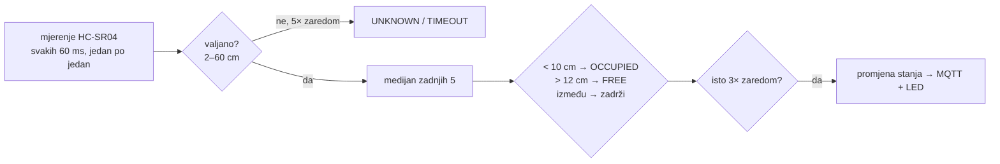

# Senzori parkirnih mjesta i firmware

Zaduženi: Toma Burgund (vlasnik) i Lovro Gale (pomoć).

## Što je već napravljeno

| | sadržaj |
|---|---|
| [firmware/](firmware) | PlatformIO projekt za ESP32: 6× HC-SR04, filtar, LED traka, spajanje na ThingsBoard kao gateway `esp32-spots` (MQTT, *access token*), stanja mjesta i broj slobodnih, Wi-Fi/MQTT reconnect, heartbeat, RPC `sim`, serijske naredbe |
| [firmware/lib/OccupancyFilter](firmware/lib/OccupancyFilter) | filtar zauzetosti (medijan 5, histereza, potvrda 3×, neispravan senzor → `UNKNOWN`), čisti C++ |
| [firmware/test/](firmware/test/test_filter/test_main.cpp) | unit testovi filtra na PC-u, uključujući kriterij "20× bez treperenja" |
| [simulator/spot_simulator_tb.py](simulator/spot_simulator_tb.py) | šalje ThingsBoardu iste poruke kao ESP32, pa ostali rade bez tvog hardvera (`spot_simulator.py` je za varijantu A) |
| [tools/kalibracija.py](tools/kalibracija.py) | iz stvarnih mjerenja predlaže pragove za svako mjesto i ispisuje redke za `config.h` |
| [tools/provjera_20x.py](tools/provjera_20x.py) | vodi te kroz test 20× postavi/makni po mjestu i piše testni zapis |
| [tablica-pragova.md](../../PROJEKT/testiranje/tablica-pragova.md) | predložak tablice pragova (isporučivo) |

Firmware je preveden i testovi filtra prolaze, ali na pravom hardveru još nije isproban. To je tvoj prvi zadatak.

## Kako radi



ESP32 je u ThingsBoardu gateway `esp32-spots` i šalje stanje uređaja `ParkingSpot-01…06` kad se promijeni, svakih
30 s i nakon svakog ponovnog spajanja, a uz to broj slobodnih, zauzetih i nepoznatih mjesta. Kad ESP32 nestane,
ThingsBoard to sam primijeti i mjesta postanu `UNKNOWN` / `OFFLINE`. Teme i poruke su u
[komunikacijskom ugovoru](../../PROJEKT/sustav/komunikacijski-ugovor.md), a sekvencijski dijagrami čvora (spajanje,
parkiranje, kvar senzora, gubitak veze, simulacija) u [varijanta-b.md](../../PROJEKT/sustav/varijanta-b.md#čvor-senzora-mjesta-esp32).

## Brzi start

1. Instaliraj [VS Code + PlatformIO](https://platformio.org/install/ide?install=vscode).
2. Kopiraj `firmware/include/secrets.example.h` u `secrets.h` i upiši Wi-Fi, IP laptopa s ThingsBoardom i
   *access token* uređaja `esp32-spots` (ispiše ga `provision.py`).
3. Spoji jedan HC-SR04 prema [shemi](../../PROJEKT/maketa/shema-spajanja.md). ECHO ide preko djelitelja 1k/2k!
4. `pio run -t upload -d firmware`, zatim `pio device monitor -d firmware`.
5. U serijskom monitoru: `status`, `cal` (sirova mjerenja), `sim 3 1` (simuliraj zauzeto P03), `sim off`.
6. U ThingsBoardu (*Entities → Devices → ParkingSpot-03 → Latest telemetry*) i na nadzornom dashboardu se stanje
   mijenja za manje od 3 s. U monitoru `ThingsBoard: connected`; `rc=4`/`rc=5` znači pogrešan token.

Unit testovi filtra, bez pločice: `pio test -e native -d firmware`.

## Kalibracija pragova

```bash
pip install pyserial
python tools/kalibracija.py --port COM5        # Linux: /dev/ttyUSB0
```

Prati upute: sva mjesta prazna, zatim autić na svakom mjestu. Alat ispiše tablicu za
[tablica-pragova.md](../../PROJEKT/testiranje/tablica-pragova.md) i redke za `SPOTS[]` u `firmware/include/config.h`.
"PROVJERITI montažu" znači da senzor nije okomit, vidi zid ili je razlika premala.

## Test prihvaćanja

```bash
python tools/provjera_20x.py --all --cycles 20 --out testni-zapis.md
```

Alat govori kad staviti i maknuti autić i broji promjene stanja. Test prolazi s 20/20 ciklusa i točno 40 promjena po
mjestu; svaka dodatna promjena je treperenje. Zapis predaj Lovri.

## Simulacija (za ostale članove)

Treba ThingsBoard s `provision.py` ([INSTALL.md §3](../INSTALL.md#3-thingsboard-laptop-ili-server-s--4-gb-ram)).

```bash
python simulator/spot_simulator_tb.py            # tipkaj "3" za promjenu P03, "3x" za kvar senzora, "k" prekid veze
python simulator/spot_simulator_tb.py --random 20
```

Pravo ESP32 može se upravljati i iz ThingsBoarda: RPC `sim` `{"spot": "P03", "occupied": true}` na uređaj
`esp32-spots` (npr. *RPC debug terminal* widget), `simOff` vraća stvarne senzore.

## Zadaci

- ✅ ESP32 firmware napisan i preveden · ⬜ isprobati na hardveru
- ✅ shema spajanja (`SOFTWARE/maketa/elektronika`)
- ✅ prijelaz na varijantu B: ThingsBoard gateway API, broj slobodnih mjesta, RPC `sim`; simulator `spot_simulator_tb.py`
- ⬜ jedan senzor s djeliteljem i stabilna mjerenja u serijskom monitoru (KT2)
- ⬜ svih 6 senzora na maketi (s Patrikom i Lovrom), kalibracija, pragovi u `config.h` i `tablica-pragova.md`
- ⬜ spajanje na pravi ThingsBoard (token `esp32-spots`), provjera na dashboardu, LED traka
- ⬜ test 20× za svako mjesto (`provjera_20x.py`) i testni zapis
- ⬜ testovi oporavka: isključi Wi-Fi router ili ThingsBoard (`docker compose stop`), mjesta u ThingsBoardu moraju
  postati `OFFLINE`, a nakon povratka ESP32 se sam spaja i šalje točna stanja
- ⬜ po potrebi rezervni senzor (IR ili VL53L0X) ako HC-SR04 na nekom mjestu ne radi pouzdano
