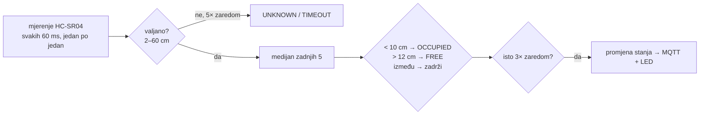

# Osoba 3 – senzori parkirnih mjesta i firmware

**Zaduženi:** Toma Burgund (vlasnik) i Lovro Gale (pomoć).

## Što je već napravljeno

| | sadržaj |
|---|---|
| [firmware/](firmware) | PlatformIO projekt za ESP32: 6× HC-SR04, filtar, MQTT, Wi-Fi/MQTT reconnect, Last Will, heartbeat, NTP, LED traka, simulacijski način, serijske naredbe |
| [firmware/lib/OccupancyFilter](firmware/lib/OccupancyFilter) | filtar zauzetosti (medijan 5, histereza, potvrda 3×, neispravan senzor → `UNKNOWN`) – čisti C++ |
| [firmware/test/](firmware/test/test_filter/test_main.cpp) | 8 unit testova filtra na PC-u, uključujući kriterij "20× bez treperenja" |
| [simulator/spot_simulator.py](simulator/spot_simulator.py) | šalje iste poruke kao ESP32 – ostali rade bez tvog hardvera |
| [tools/kalibracija.py](tools/kalibracija.py) | iz stvarnih mjerenja predlaže pragove za svako mjesto i ispisuje redke za `config.h` |
| [tools/provjera_20x.py](tools/provjera_20x.py) | vodi te kroz test 20× postavi/makni po mjestu i piše testni zapis |
| [tablica-pragova.md](../../PROJEKT/testiranje/tablica-pragova.md) | predložak tablice pragova (isporučivo) |

Firmware je preveden za ESP32 (RAM 14 %, flash 59 %), testovi filtra prolaze. **Nije još isproban na pravom
hardveru** – to je tvoj prvi zadatak.

## Kako radi



Poruka (retained) na `garage/parking/spot/P03/telemetry` – vidi [komunikacijski ugovor](../../PROJEKT/sustav/komunikacijski-ugovor.md):
```json
{"spotId":"P03","state":"OCCUPIED","occupied":true,"distanceCm":6.4,"sensorStatus":"OK",
 "deviceId":"esp32-spots","uptimeMs":512345,"timestamp":"2026-10-19T08:30:00Z"}
```
Šalje se: na promjenu, svakih 30 s (heartbeat) i nakon svakog ponovnog spajanja.

## Brzi start

1. Instaliraj [VS Code + PlatformIO](https://platformio.org/install/ide?install=vscode).
2. `firmware/include/secrets.example.h` → kopiraj u `secrets.h`, upiši Wi-Fi i IP edge računala.
3. Spoji **jedan** HC-SR04 prema [shemi](../../PROJEKT/maketa/shema-spajanja.md) – **ECHO preko djelitelja 1k/2k!**
4. `pio run -t upload -d firmware` pa `pio device monitor -d firmware`.
5. U serijskom monitoru: `status`, `cal` (sirova mjerenja), `sim 3 1` (simuliraj zauzeto P03), `sim off`.
6. Na laptopu: `python -m garage_contract.monitor` – poruke moraju biti zelene.

Unit testovi filtra (bez pločice): `pio test -e native -d firmware`.

## Kalibracija pragova

```bash
pip install pyserial
python tools/kalibracija.py --port COM5        # Linux: /dev/ttyUSB0
```
Prati upute (sva mjesta prazna → autić na svakom mjestu). Alat ispiše tablicu za
[tablica-pragova.md](../../PROJEKT/testiranje/tablica-pragova.md) i redke za `SPOTS[]` u `firmware/include/config.h`.
Ako za neko mjesto javi "PROVJERITI montažu": senzor nije okomit, vidi zid ili je razlika premala.

## Test prihvaćanja (kriterij iz plana)

```bash
python tools/provjera_20x.py --all --cycles 20 --out testni-zapis.md
```
Alat govori kad staviti i maknuti autić i broji promjene stanja. Prolaz = 20/20 ciklusa i točno 40
promjena po mjestu (svaka dodatna promjena = treperenje). Zapis predaj osobi 8.

## Simulacija (za ostale članove)

```bash
python simulator/spot_simulator.py            # tipkaj "3" za promjenu P03, "3x" za kvar senzora
python simulator/spot_simulator.py --random 20
```

## Tvoji zadaci

- [ ] jedan senzor + djelitelj → stabilna mjerenja u serijskom monitoru (tjedan 1)
- [ ] svih 6 senzora na maketi (s osobom 2), kalibracija, pragovi u `config.h`
- [ ] MQTT s pravim brokerom, provjera monitorom, LED traka
- [ ] test 20× za svako mjesto → `testni-zapis.md`
- [ ] testovi oporavka: isključi Wi-Fi router / Mosquitto → ESP32 se sam vrati i ponovno pošalje stanja
- [ ] po potrebi: rezervni senzor (IR ili VL53L0X) ako HC-SR04 na nekom mjestu ne radi pouzdano

| isporučivo | status |
|---|---|
| ESP32 firmware | ✅ napisan i preveden, ⬜ isprobati na hardveru |
| shema povezivanja | ✅ `SOFTWARE/maketa/elektronika` |
| tablica pragova za svako mjesto | ⬜ `tablica-pragova.md` (alat spreman) |
| testni zapis mjerenja | ⬜ `provjera_20x.py` |
| MQTT poruke za sva mjesta | ✅ prema ugovoru, simulator za usporedbu |
