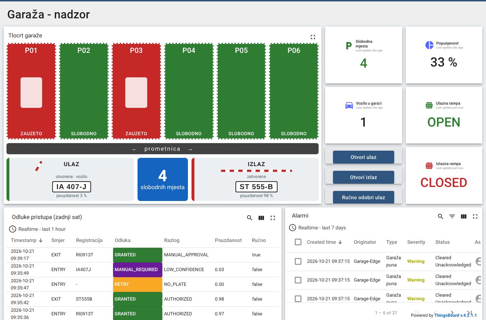
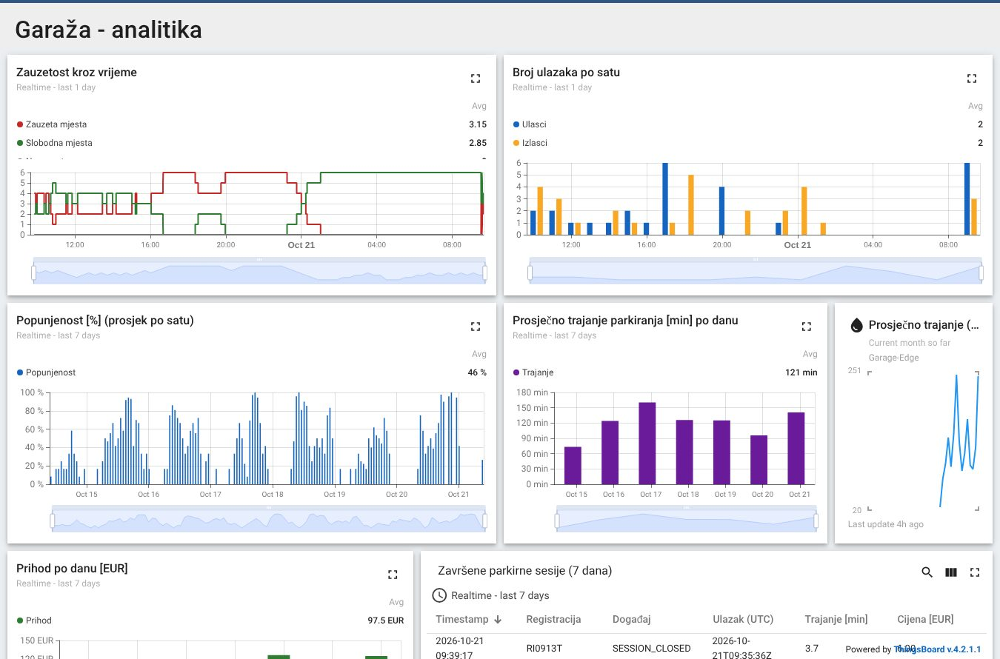

# ThingsBoard: digitalni blizanac i dashboardi

Zaduženi: Anja (vlasnica: instalacija, provisioning, bridge, nadzorni dashboard, alarmi i obavijesti) i Leo
Hreljanović (analitički dashboard i pristup podacima za [mobilnu aplikaciju](../mobilna-aplikacija), koja podatke
čita preko ThingsBoard REST API-ja).

ThingsBoard je digitalni blizanac, nadzor i analitika i nikad nije jedina komponenta potrebna za otvaranje rampe.

## Što je već napravljeno (isprobano na ThingsBoard CE 4.2.1)

| | sadržaj |
|---|---|
| [docker-compose.yml](docker-compose.yml) | ThingsBoard CE i PostgreSQL u jednom kontejneru, podaci u imenovanim volumenima (preživljavaju restart) |
| [provision/provision.py](provision/provision.py) | jednom naredbom napravi sve: profile uređaja s pravilima alarma, uređaje, asset "Garage" s relacijama, atribute, uvoz dashboarda; smije se pokretati više puta |
| [bridge/](bridge) | most Mosquitto → ThingsBoard (Gateway MQTT API) s lokalnim međuspremnikom; RPC gumbi s dashboarda postaju ručne radnje |
| [dashboards/](dashboards) | 2 dashboarda (JSON) i generator `build_dashboards.py` |
| [tools/seed_history.py](tools/seed_history.py) | fiktivna povijest za razvoj analitike (`--clear` prije prave demonstracije!) |
| [entiteti-i-alarmi.md](../../PROJEKT/sustav/entiteti-i-alarmi.md) | popis uređaja, telemetrijskih ključeva i pravila alarma |
| [tests/](tests) | testovi mapiranja, međuspremnika i RPC-a |

ThingsBoard CE nema generičku "MQTT Integration" (ona postoji samo u PE/Cloud izdanju), pa se bridge spaja kao
gateway uređaj `Garage-Edge` s jednom vezom za sve uređaje ([odluka D-001](../../PROJEKT/upravljanje/odluke.md)).
Mapiranje tema na uređaje je u [bridge/tb_bridge/mapping.py](bridge/tb_bridge/mapping.py).

### Glavni dashboard "Garaža – nadzor"

### Analitički dashboard "Garaža – analitika" (ovdje s fiktivnom poviješću)

## Pokretanje

Instalacija i provisioning su u [INSTALL.md §4](../INSTALL.md#4-thingsboard-laptop-ili-server-s--4-gb-ram). Bridge
na edge računalu pokreće Docker; na laptopu ga pokreneš s `python -m tb_bridge` (varijable `TB_HOST`,
`TB_MQTT_PORT=1884`, `TB_GATEWAY_TOKEN`, `MQTT_HOST`).

ThingsBoardov MQTT port je preusmjeren s 1883 na 1884, jer 1883 koristi Mosquitto. Za demonstraciju promijeni
lozinku tenanta, pokreni `provision.py --token <tajni-token>` i isti token stavi u `TB_GATEWAY_TOKEN` bridgea.

## Alarmi i obavijesti

Pravila alarma su u profilima uređaja koje stvara `provision.py` (popis je u
[entiteti-i-alarmi.md](../../PROJEKT/sustav/entiteti-i-alarmi.md)). Alarmi se propagiraju na asset Garage i vide se
u tablici na dashboardu.

ThingsBoard CE već ima uključeno pravilo *New alarm*, koje šalje obavijest u aplikaciji (zvonce). Za ostale kanale:

- e-mail: *Settings → Mail server* (npr. Gmail SMTP s app-lozinkom), zatim u *Notification center → Rules → New alarm*
  dodaj dostavnu metodu Email;
- webhook (Slack, Discord, vlastiti servis): u *Rule chains → Root* nakon "Device Profile Node" (izlaz *Alarm Created*)
  dodaj čvor REST API Call s URL-om webhooka.

## Zadaci

- ✅ ThingsBoard instanca (compose), uređaji i asseti (`provision.py`), dva dashboarda, 7 pravila alarma
- ✅ izvoz dashboarda u `dashboards/*.json`; rule chain je zadani (Root), izvesti ga ako ga mijenjaš
- ⬜ pokrenuti ThingsBoard i `provision.py` na laptopu ili poslužitelju koji ide na demonstraciju
- ⬜ bridge na edge računalu s IP-om ThingsBoarda (`SOFTWARE/edge/deploy` ga već pokreće)
- ⬜ prilagoditi dashboarde (boje, raspored, mobilni prikaz) i izvesti promjene (*Export dashboard*) u `dashboards/*.json`
- ⬜ obavijest e-mailom ili webhookom (opcionalno)
- ⬜ provjera: promjena mjesta vidljiva za manje od 3 s, a nakon `docker compose restart` ništa ne nestaje (TC-T06)
- ⬜ prije demonstracije `python tools/seed_history.py --clear`
