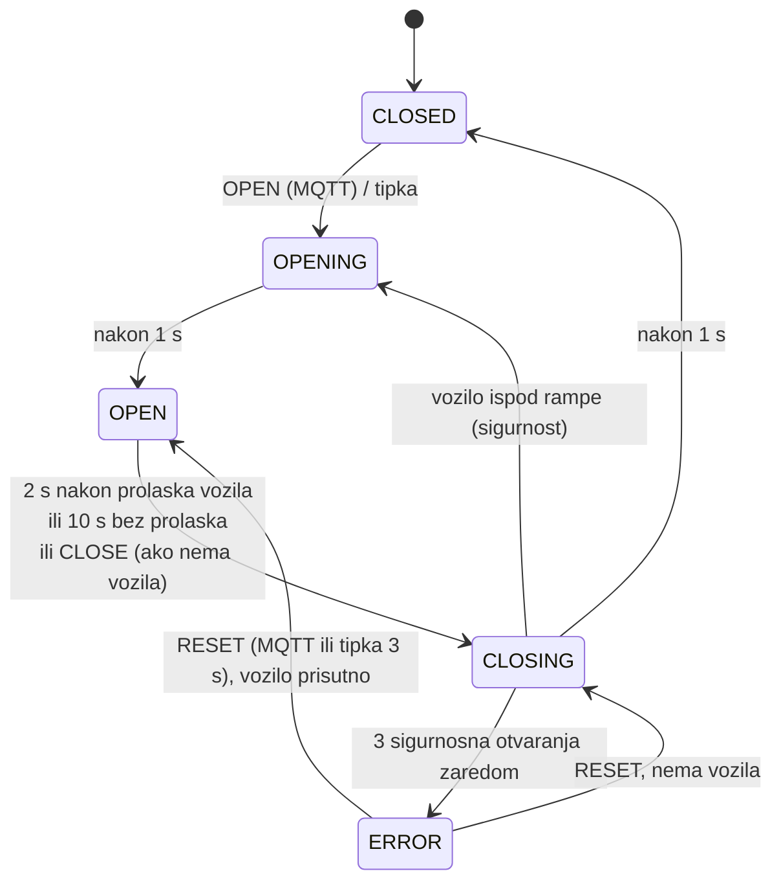

# Osoba 4 – rampe, aktuatori i lokalna kontrola pristupa

**Zadužen:** Luka Oslić – rampe i aktuatori, a s Lukasom i pravila lokalne kontrole pristupa (`decisions.py` i `access_control.py` u [osoba-6-ocr-edge/edge_service](../osoba-6-ocr-edge/edge_service)). Zamjena: Lukas Davorija.

Rampa **izvršava** naredbe i čuva sigurnost (ne zatvara se na vozilo); **ne odlučuje** smije li vozilo ući –
to radi access control na edge računalu (osoba 6).

## Što je već napravljeno

| | sadržaj |
|---|---|
| [firmware/](firmware) | PlatformIO projekt za ESP32: 2 servo rampe, IR senzori, LED, tipke, zujalica, MQTT naredbe i potvrde, Last Will, heartbeat |
| [firmware/lib/GateLogic](firmware/lib/GateLogic) | stroj stanja rampe (`CLOSED/OPENING/OPEN/CLOSING/ERROR`) – čisti C++ |
| [firmware/test/](firmware/test/test_gate/test_main.cpp) | 7 unit testova stroja stanja na PC-u |
| [simulator/](simulator) | Python blizanac istog stroja stanja + MQTT simulator obje rampe (+ 6 testova) |
| [sigurnosni-testovi.md](sigurnosni-testovi.md) | sigurnosni testovi s koracima i očekivanim rezultatom |

Firmware je preveden (RAM 14 %, flash 61 %), testovi prolaze. **Na hardveru još nije isproban.**

## Stroj stanja



- `CLOSE` dok je vozilo ispod rampe → odbijeno (`success:false, reason:"VEHICLE_PRESENT"`).
- Svaka naredba ima `requestId`; isti `requestId` drugi put → potvrda `DUPLICATE`, bez ponovnog izvršavanja.
- U `ERROR` rampa ostaje gore (ne može ozlijediti vozilo) dok je netko ne resetira.
- Sve radi **lokalno**: bez Wi-Fi-ja/MQTT-a tipka i dalje otvara, rampa se i dalje sama zatvara.

Poruke (detalji u [ugovoru](../osoba-1-voditelj/komunikacijski-ugovor.md)):
```json
// garage/gate/entrance/command
{"requestId":"req-1024","command":"OPEN","reason":"AUTHORIZED_ENTRY","plate":"ZG1234AB"}
// garage/gate/entrance/state (retained) - odgovor
{"gate":"ENTRANCE","state":"OPENING","vehiclePresent":true,"requestId":"req-1024","success":true,
 "reason":null,"source":"MQTT","deviceId":"esp32-gates","timestamp":"2026-10-19T08:31:14Z"}
```
Access control očekuje potvrdu u 3 s; inače ponovi naredbu jednom pa podigne alarm `GATE_NO_ACK`.

## Brzi start

1. `firmware/include/secrets.example.h` → `secrets.h` (Wi-Fi, IP edge računala).
2. Spoji jedan SG90 (napajanje iz 5 V adaptera, **ne** iz ESP32), IR senzor na **3,3 V**, tipku, LED – [shema](../osoba-2-maketa/elektronika/shema-spajanja.md).
3. `pio run -t upload -d firmware`, `pio device monitor -d firmware`.
4. Serijski: `open e`, `close e`, `reset e`, `status` (`x` = izlaz).
5. MQTT: `python -m edge_service manual open --gate entrance` ili
   `python -m garage_contract.monitor --pub garage/gate/entrance/command '{"requestId":"t1","command":"OPEN"}'`.
6. Kalibriraj kutove u `config.h` (`closedAngle`, `openAngle`) da ruka bude vodoravna/okomita.

Unit testovi: `pio test -e native -d firmware` i `pytest simulator`.

## Simulator (za ostale članove)

```bash
python simulator/gate_simulator.py                 # "e" = vozilo na ulazu, "be" = tipka ulaza
python simulator/gate_simulator.py --no-ack exit   # izlazna rampa ne odgovara -> test alarma
```
Python simulator i C++ firmware implementiraju **isti** stroj stanja – ako mijenjaš jedan, promijeni i drugi
(i njihove testove).

## Tvoji zadaci

- [ ] tjedan 1: jedan servo pokrenut s ESP32-a
- [ ] montaža obje rampe s osobom 2, kalibracija kutova, LED i tipke
- [ ] IR senzori na crti rampe – provjeri da vide autić (i ne vide ruku rampe!)
- [ ] provesti [sigurnosne testove](sigurnosni-testovi.md), rezultate predati osobi 8
- [ ] test bez mreže: isključi router → tipka radi, automatsko zatvaranje radi; uključi → stanje se ponovno objavi

| isporučivo | status |
|---|---|
| funkcionalne dvije rampe | ⬜ hardver |
| firmware / upravljački servis | ✅ |
| definirana MQTT sučelja | ✅ ugovor + simulator |
| sigurnosni testovi | ✅ plan, ⬜ provedba |
| ručno upravljanje u slučaju kvara ALPR-a | ✅ tipka, serijski, dashboard gumb, `edge_service manual` |
