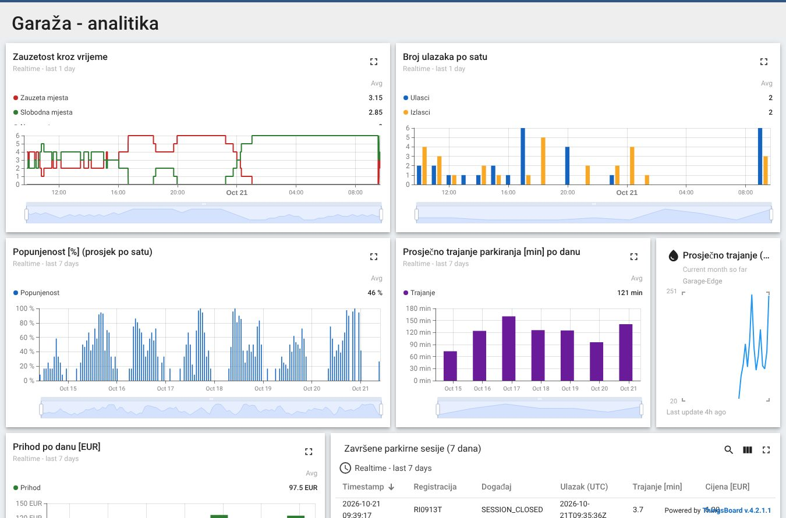

# Osoba 7 – ThingsBoard, MQTT, digitalni blizanac i dashboard

**Zaduženi:** Anja (vlasnica – instalacija, provisioning, bridge, nadzorni dashboard, alarmi i obavijesti) i Leo Hreljanović (analitički dashboard i pristup podacima za mobilnu aplikaciju za analitiku garaže, koja podatke čita preko ThingsBoard REST API-ja).

ThingsBoard je **digitalni blizanac, nadzor i analitika** – nikad jedina komponenta potrebna za otvaranje rampe.

## Što je već napravljeno (i isprobano na ThingsBoard CE 4.2.1)

| | sadržaj |
|---|---|
| [docker-compose.yml](docker-compose.yml) | ThingsBoard CE + PostgreSQL u jednom kontejneru, podaci u imenovanim volumenima (preživljavaju restart) |
| [provision/provision.py](provision/provision.py) | **jednom naredbom** napravi sve: 5 profila uređaja s pravilima alarma, 11 uređaja, asset "Garage" s relacijama, atribute, uvoz dashboarda (može se pokretati više puta) |
| [bridge/](bridge) | most Mosquitto → ThingsBoard (Gateway MQTT API) s **lokalnim međuspremnikom**, RPC gumbi s dashboarda → ručne radnje |
| [dashboards/](dashboards) | 2 dashboarda (JSON) + generator `build_dashboards.py` |
| [tools/seed_history.py](tools/seed_history.py) | fiktivna povijest za razvoj analitike (`--clear` prije prave demonstracije!) |
| [entiteti-i-alarmi.md](entiteti-i-alarmi.md) | popis uređaja, telemetrijskih ključeva i pravila alarma |
| [tests/](tests) | 11 testova mapiranja, međuspremnika i RPC-a |

**Provjereno:** podaci stižu < 1 s; 12 poruka poslanih dok je ThingsBoard bio ugašen stiglo je nakon
ponovnog pokretanja s izvornim vremenom; dashboardi i 7-dnevna povijest ostali su nakon restarta;
gumb "Otvori ulaz" na dashboardu otvara rampu (dashboard → RPC → bridge → access control → ESP32).

### Glavni dashboard "Garaža – nadzor"


### Analitički dashboard "Garaža – analitika" (ovdje s fiktivnom poviješću)


## Arhitektura

```
ESP32 / edge servisi --MQTT--> Mosquitto (edge, :1883) --> tb_bridge --(gateway API, :1884)--> ThingsBoard
                                      ^                        |  SQLite buffer kad TB ne radi
                                      +---- access/manual <----+  <-- RPC s dashboarda (gumbi)
```

ThingsBoard CE nema generičku "MQTT Integration" (to je PE/Cloud). Zato se bridge spaja kao **gateway uređaj**
`Garage-Edge` (jedna veza za sve uređaje) – to radi u CE. Mapiranje tema → uređaja je u
[bridge/tb_bridge/mapping.py](bridge/tb_bridge/mapping.py).

## Brzi start

```bash
docker compose up -d                       # prvi put ~2 min (instalacija baze); http://localhost:8080
python provision/provision.py              # tenant@thingsboard.org / tenant
python -m tb_bridge                        # TB_HOST, TB_MQTT_PORT=1884, TB_GATEWAY_TOKEN, MQTT_HOST
python ../osoba-1-voditelj/integracija/simulacija.py --broker --tb    # podaci bez hardvera
```

Za demonstraciju: **promijeni lozinku** tenanta, pokreni `provision.py --token <tajni-token>` i isti token
stavi u `TB_GATEWAY_TOKEN` bridgea. Na ThingsBoardu je port 1883 preusmjeren na **1884** jer 1883 koristi Mosquitto.

## Alarmi i obavijesti

Pravila alarma su u profilima uređaja (stvara ih `provision.py`) – vidi [entiteti-i-alarmi.md](entiteti-i-alarmi.md):
nema podataka sa senzora, ALPR uzastopno ne uspijeva, rampa ne potvrđuje naredbe / u kvaru, garaža puna,
potrebna ručna intervencija, uređaj nije dostupan. Alarmi se propagiraju na asset **Garage** (tablica na dashboardu).

**Obavijesti:** ThingsBoard CE već ima uključeno pravilo *New alarm* → obavijest u aplikaciji (zvonce).
- e-mail: *Settings → Mail server* (npr. Gmail SMTP s app-lozinkom), pa u *Notification center → Rules → New alarm* dodaj dostavnu metodu Email
- webhook (Slack, Discord, vlastiti servis): u *Rule chains → Root* nakon "Device Profile Node" (izlaz *Alarm Created*) dodaj čvor **REST API Call** s URL-om webhooka

## Tvoji zadaci

- [ ] pokrenuti ThingsBoard na laptopu (ili poslužitelju) koji će biti na demonstraciji, `provision.py`
- [ ] bridge na edge računalu (`osoba-6-ocr-edge/deploy` ga već pokreće) s IP-om ThingsBoarda
- [ ] prilagoditi dashboarde (boje, raspored, mobilni prikaz); promjene izvesti (*Export dashboard*) u `dashboards/*.json`
- [ ] obavijest e-mailom ili webhookom (opcionalno)
- [ ] test kriterija: promjena mjesta vidljiva u < 3 s; `docker compose restart` → ništa ne nestaje (TC-T06)
- [ ] prije demonstracije `python tools/seed_history.py --clear`

| isporučivo | status |
|---|---|
| ThingsBoard instanca | ✅ compose (pokrenuti na svom računalu) |
| konfigurirani uređaji i asseti | ✅ `provision.py` |
| najmanje dva dashboarda | ✅ nadzor + analitika |
| alarmi | ✅ 7 pravila u profilima |
| izvoz konfiguracije dashboarda i rule chainova | ✅ `dashboards/*.json`; rule chain je zadani (Root) – izvesti ako ga mijenjaš |
