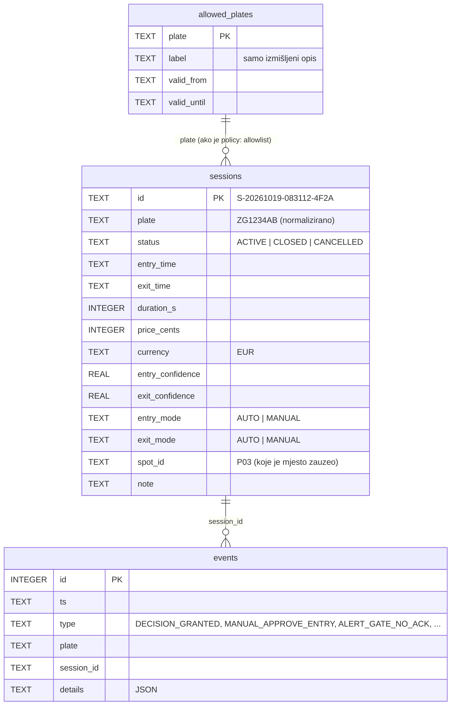

# Model podataka

SQLite baza na edge računalu (`GARAGE_DB`, zadano `data/garage.db`), shema u
[sessions/parking_sessions/store.py](sessions/parking_sessions/store.py) (verzija 1).
Sva vremena su tekst **UTC ISO 8601** (`2026-10-19T08:31:12Z`) – čitljivo u bilo kojem SQLite alatu
(npr. [DB Browser for SQLite](https://sqlitebrowser.org)). Novac u **centima** (cijeli broj, bez grešaka zaokruživanja).



Pravila koja čuva baza:
- **jedno vozilo može biti unutra samo jednom**: djelomični jedinstveni indeks `ux_sessions_active_plate`
  na `plate WHERE status = 'ACTIVE'`
- aktivne sesije se nikad ne brišu (`purge` briše samo završene)
- WAL način: CLI može čitati dok servis piše

## Pravilo naplate

| trajanje | cijena (profil `real`) |
|---|---|
| 0 – 15:00 min | 0,00 € |
| 15:01 min – 1 h | 1,50 € |
| svaki daljnji započeti sat | +1,50 € |
| najviše po započetom danu (24 h) | 15,00 € |

Profil **`demo`**: vrijeme × 60 (1 minuta se naplaćuje kao 1 sat, prvih 15 s besplatno) – da se u demonstraciji
od par minuta vidi cijena. Odabir: `PRICING_PROFILE=demo|real`. Implementacija i testovi graničnih slučajeva:
[pricing.py](sessions/parking_sessions/pricing.py), [test_sessions.py](sessions/tests/test_sessions.py).

## API (servisne funkcije)

```python
from parking_sessions import SessionStore, PricingPolicy
store = SessionStore("data/garage.db", PricingPolicy.demo())
s = store.open_session("ZG1234AB", confidence=0.93)          # ActiveSessionExists ako je već unutra
store.find_active("ZG1234AB")                                  # aktivna sesija ili None
s = store.close_session(s.id, confidence=0.91)                 # trajanje + cijena
store.quote_cents(s.id)                                        # koliko bi koštalo sada
store.history(plate="ZG1234AB", since=..., limit=50)           # povijest
store.stats(since=...)                                         # broj, prosječno trajanje, prihod, ulasci po satu
store.allow("ZG1234AB", label="Testno vozilo 1"); store.is_allowed("ZG1234AB")
store.log_event("MANUAL_APPROVE_ENTRY", plate="ZG1234AB", operator="dezurni", note="...")
store.purge(older_than_days=30)                                # privatnost
```
